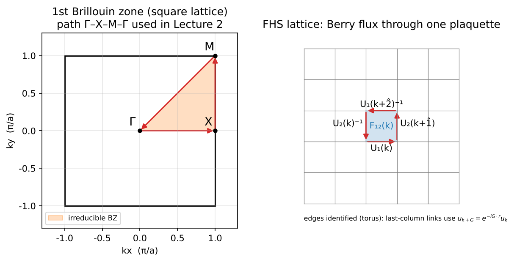
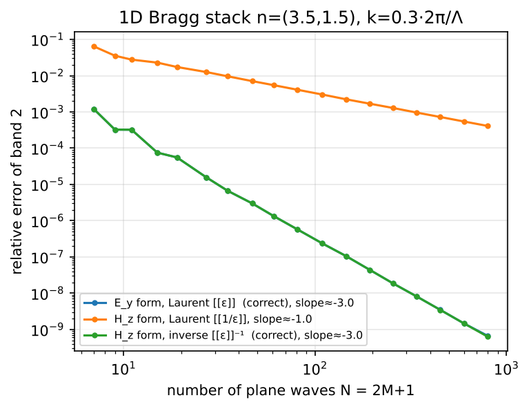
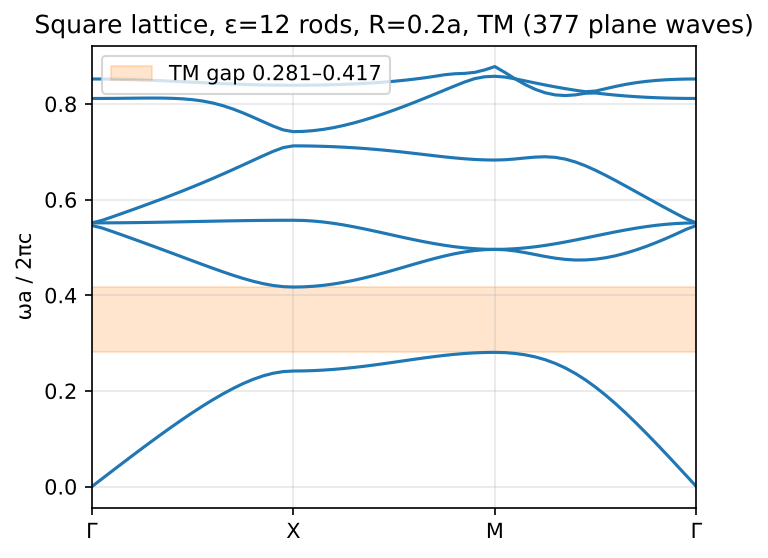
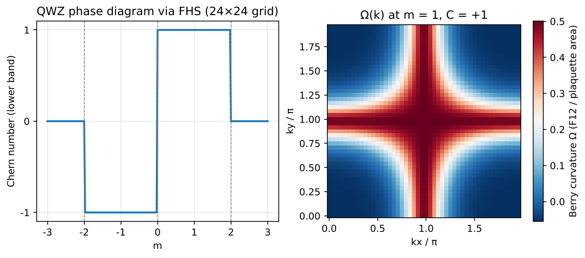
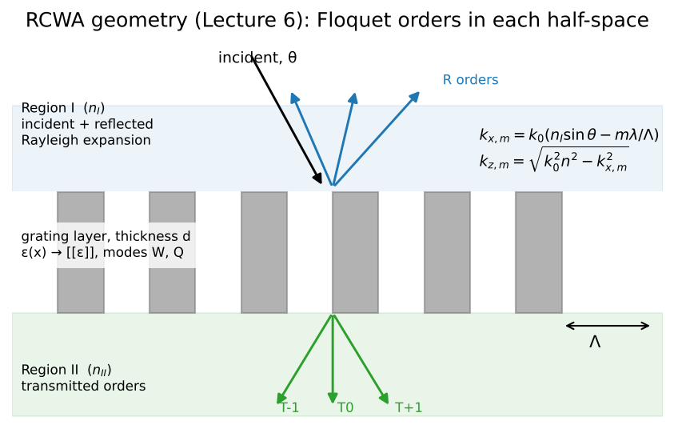
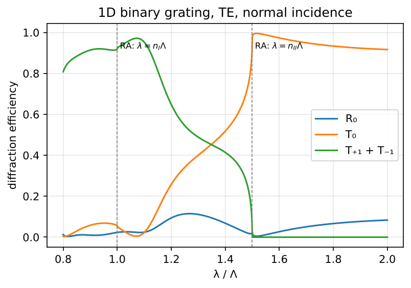
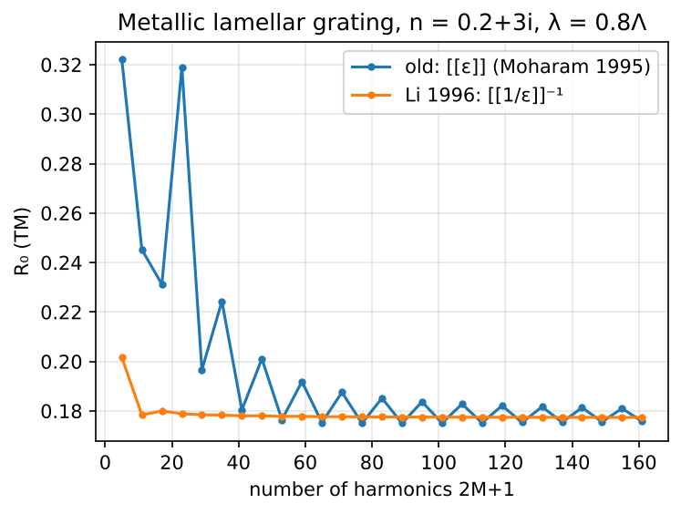
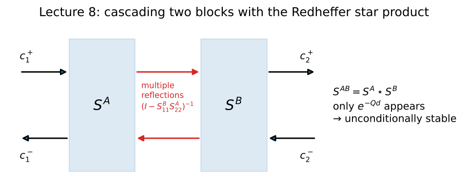
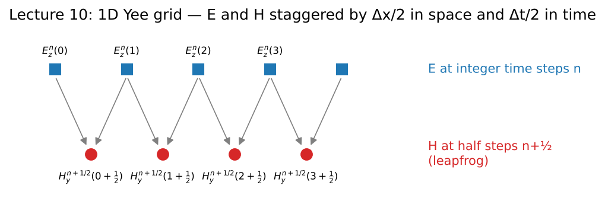

# 計算電磁學與拓撲光子學：從平面波展開到可微分 RCWA

Oct 29, 2026 · @jr lu（修訂版：2026-11-04）

> **修訂說明**：本版修正了原稿的公式錯誤、慣例不一致與引用問題，補上術語定義、示意圖與可執行範例。逐條修改紀錄見 [`review/changelog.md`](../review/changelog.md)。數學式採 `$…$`／`$$…$$`，可在 GitHub、VS Code、Typora、Obsidian、HackMD 中正常算繪。

## 課程概述

本講義用 11 講（另加 1 講伴讀）串起一條完整的計算電磁學主線：從光子能帶的本徵問題出發，算出拓撲不變量，再走到 RCWA、FDTD／GPU 與可微分逆向設計。每講都以「推導 → 演算法 → 可驗證的程式作業」收尾。

本講義會用到的方法與工具，第一次出現時先在這裡定義：

| 縮寫 | 全名 | 一句話說明 |
| --- | --- | --- |
| PWE | Plane-Wave Expansion，平面波展開法 | 把週期結構的場展開成平面波，求能帶 $\omega_n(\mathbf k)$ 的頻域本徵解法（第 2 講） |
| RCWA | Rigorous Coupled-Wave Analysis，嚴格耦合波分析；又稱 FMM（Fourier Modal Method） | 固定頻率下，求週期性分層結構的繞射與穿透（第 6–8 講） |
| FDTD | Finite-Difference Time-Domain，時域有限差分法 | 在交錯網格上直接對時間積分馬克士威方程（第 10 講） |
| MPB | MIT Photonic Bands | 開源 PWE 能帶求解器，採迭代本徵解法（[文件](https://mpb.readthedocs.io)） |
| S4 | Stanford Stratified Structure Solver | 開源 RCWA 求解器（Liu & Fan, 2012） |
| Meep | MIT Electromagnetic Equation Propagation | 開源 FDTD 求解器（Oskooi 等人, 2010） |

**先修**：電磁學（研究所程度）、線性代數（Hermitian 算子、廣義本徵問題）、傅立葉分析、Python／NumPy。量子力學只需大學程度；第 5 講的量子場論內容為伴讀，不影響主線。

**設計原則**

- 每一個數值結果都要有獨立的對照答案：解析解、MPB、S4，或能量守恆。
- 先求正確，再求快：Python 原型 → 測試 → C++／GPU 改寫。
- 每講的作業都是公開 repo 中的一個可執行範例。本 repo 的 [`demos/`](../demos) 已提供第 1–3、6–7 講的最小參考實作。

| 講次 | 主題 | 階段 | 建議時程 | 交付物 |
| --- | --- | --- | --- | --- |
| 1–2 | 本徵問題與 PWE | 第一階段 | 第 1–5 週 | 方晶格能帶，對照 MPB |
| 3–4 | Berry 曲率、Chern 數、邊緣態 | 第一階段 | 第 6–12 週 | 非零 Chern 數 + 超晶胞邊緣態 |
| 5（伴讀） | 量子異常 | 與第 1–4 講並行 | 第 1–12 週 | 讀書筆記 |
| 6–8 | RCWA、Li 法則、S 矩陣 | 第二階段 | 第 4–7 個月 | 1D/2D RCWA，對照 S4 |
| 9 | C++ 核心與 pybind11 | 第二階段 | 第 7–9 個月 | pip 可安裝套件 |
| 10 | FDTD 與 GPU | 第二階段 | 第 4–9 個月（並行） | 加速倍率報告 |
| 11 | 可微分求解器與 adjoint | 第三階段 | 第 9–18 個月 | 逆向設計示範 |
| — | 整合、發表 | 第四階段 | 第 18–24 個月 | 研討會發表、作品集 |

**每週節奏（8–10 小時）**：平日 3 個晚上各 1.5 小時讀推導與寫程式，週末一個 4 小時區塊做整合、驗證與寫筆記。伴讀的第 5 講另計每週 2–3 小時。

**評量**：每講的「驗收標準」就是期末考。達不到就不往下走，回頭縮小範圍。

## 全書符號與慣例

所有講次都採用下列慣例。RCWA 文獻（如 Moharam 1995）常用工程慣例 $e^{+j\omega t}$，引用公式時要先換成本表的慣例。

| 項目 | 本講義的慣例 |
| --- | --- |
| 時諧因子 | $e^{-i\omega t}$。沿 $+z$ 傳播或衰減的平面波寫成 $e^{+ik_z z}$；平方根分支取 $\operatorname{Im}k_z>0$，實數時取 $k_z>0$ |
| 橫向展開 | $f(x)=\sum_m f_m e^{+ik_{x,m}x}$；Bloch 波 $\psi_{\mathbf k}=e^{i\mathbf k\cdot\mathbf r}u_{\mathbf k}$ |
| 卷積矩陣 | $[\![f]\!]_{mn}=f_{m-n}$，即函數 $f$ 的傅立葉係數所組成的矩陣（1D 時為 Toeplitz 矩陣） |
| 真空波數 | $k_0=\omega/c=2\pi/\lambda$；以 $k_0$ 無因次化：$z'=k_0z$、$d'=k_0d$、$\mathbf K_x=\operatorname{diag}(k_{x,m}/k_0)$ |
| 波長與週期 | $\lambda$：真空波長；$\Lambda$：光柵週期；$a$：光子晶體晶格常數 |
| 層內模態 | $\mathbf W$：本徵向量（模態剖面）；$\mathbf K_z=\operatorname{diag}(k_{z,q}/k_0)$：縱向傳播常數（與 Moharam 的 $\mathbf Q$ 關係為 $\mathbf Q=-i\mathbf K_z$） |
| 本徵值矩陣 | 一般矩陣的本徵分解寫成 $\mathbf A=\mathbf W\mathbf D\mathbf W^{-1}$，$\mathbf D=\operatorname{diag}(d_i)$ |
| 伴隨變數 | $\mathbf v$（第 11 講），避免與波長 $\lambda$ 混淆 |
| 頻率單位 | 能帶一律以 $\omega a/2\pi c$（$=a/\lambda$）表示 |

## 第 1 講：馬克士威方程作為 Hermitian 本徵問題

> **核心結論**：在線性、無損、無色散的介質中，光子晶體的模態就是一個 Hermitian 算子的本徵態，所以頻率是實數、模態正交，能帶理論的整套工具都能直接搬過來。

**學習目標**：寫出主方程並證明其 Hermitian 性；理解 Bloch 定理如何把無限問題化成單一晶胞；能用尺度不變性換算設計；會用轉移矩陣算一維週期結構的能帶。

### 1.1 主方程

假設時諧場 $e^{-i\omega t}$、無自由電荷與電流、$\mu=\mu_0$、$\varepsilon(\mathbf r)$ 為正實數。由 $\nabla\times\mathbf E=i\omega\mu_0\mathbf H$ 與 $\nabla\times\mathbf H=-i\omega\varepsilon_0\varepsilon\mathbf E$ 消去 $\mathbf E$，得到磁場的主方程：

$$
\Theta\mathbf H\equiv\nabla\times\left(\frac{1}{\varepsilon(\mathbf r)}\nabla\times\mathbf H\right)=\left(\frac{\omega}{c}\right)^2\mathbf H,\qquad\nabla\cdot\mathbf H=0 \tag{1.1}
$$

在內積 $\langle\mathbf F,\mathbf G\rangle=\int\mathbf F^*\cdot\mathbf G\,d^3r$ 下，並在週期邊界條件（或場在無窮遠處衰減）下，分部積分的邊界項為零，因此 $\Theta$ 是 Hermitian 且半正定（$\langle\mathbf H,\Theta\mathbf H\rangle=\int\varepsilon^{-1}|\nabla\times\mathbf H|^2\ge0$）。兩個直接推論：$\omega^2$ 為非負實數；不同頻率的模態彼此正交。

橫向條件 $\nabla\cdot\mathbf H=0$ 不能省：任何梯度場 $\mathbf H=\nabla\phi$ 都滿足 $\Theta\mathbf H=0$，會成為 $\omega=0$ 的縱向假解，數值上也會以偽模態的形式出現。

### 1.2 Bloch 定理與布里淵區

若 $\varepsilon(\mathbf r+\mathbf R)=\varepsilon(\mathbf r)$ 對所有晶格向量 $\mathbf R$ 成立，$\Theta$ 與平移算子對易，模態可寫成

$$
\mathbf H_{n\mathbf k}(\mathbf r)=e^{i\mathbf k\cdot\mathbf r}\,\mathbf u_{n\mathbf k}(\mathbf r),\qquad
\Theta_{\mathbf k}=(\nabla+i\mathbf k)\times\frac{1}{\varepsilon}(\nabla+i\mathbf k)\times \tag{1.2}
$$

其中 $\mathbf u_{n\mathbf k}$ 與晶格同週期。**倒晶格向量** $\mathbf G$ 滿足 $e^{i\mathbf G\cdot\mathbf R}=1$；$\mathbf k$ 與 $\mathbf k+\mathbf G$ 描述同一組態，所以 $\mathbf k$ 只需取遍**第一布里淵區**（離原點比離任何其他倒晶格點都近的區域）。若結構還有點群對稱，可再縮小到**不可約布里淵區**；能帶圖通常沿其邊界的高對稱路徑畫出（方晶格為 Γ–X–M–Γ，見下圖左）。能帶 $\omega_n(\mathbf k)$ 就是這族本徵值隨 $\mathbf k$ 的變化。第 3 講的 Berry 曲率，正是定義在 $\mathbf u_{n\mathbf k}$ 隨 $\mathbf k$ 變化的幾何上。

*圖 1.1　左：方晶格的第一布里淵區、不可約區（橙色）與高對稱路徑 Γ–X–M–Γ。右：第 3 講 FHS 方法的格子（之後會用到）。*

### 1.3 二維結構：TE 與 TM 分離

對 $z$ 方向均勻的 2D 晶體且 $k_z=0$，場分成兩個獨立的純量問題。本講義採 Joannopoulos 的慣例：TM 指電場沿 $z$。

$$
\text{TM }(E_z):\quad-\nabla^2E_z=\left(\frac{\omega}{c}\right)^2\varepsilon(\mathbf r)\,E_z \tag{1.3a}
$$

$$
\text{TE }(H_z):\quad-\nabla\cdot\left(\frac{1}{\varepsilon(\mathbf r)}\nabla H_z\right)=\left(\frac{\omega}{c}\right)^2H_z \tag{1.3b}
$$

TM 是廣義 Hermitian 本徵問題（右邊有 $\varepsilon$ 權重，對應的內積為 $\langle u,v\rangle_\varepsilon=\int\varepsilon\,u^*v$）；TE 是標準 Hermitian 問題，但算子裡有 $1/\varepsilon$。這個差異在第 2 講決定了傅立葉展開要怎麼做。（注意：此 TE／TM 命名與波導、光柵文獻的習慣相反，第 6 講會再說明。）

### 1.4 尺度不變性與變分原理

若 $\varepsilon'(\mathbf r)=\varepsilon(\mathbf r/s)$，則 $\omega'=\omega/s$：馬克士威方程沒有基本長度尺度，所以能帶一律用無因次頻率 $\omega a/2\pi c$ 表示。

**變分原理**：最低能帶的頻率是 Rayleigh 商的最小值，

$$
\left(\frac{\omega_0}{c}\right)^2=\min_{\nabla\cdot(\varepsilon\mathbf E)=0}\frac{\int|\nabla\times\mathbf E|^2\,d^3r}{\int\varepsilon(\mathbf r)|\mathbf E|^2\,d^3r} \tag{1.4}
$$

更高的能帶則要在與較低能帶正交的子空間內取最小值。分子懲罰場的空間變化，分母獎勵電場能量落在高 $\varepsilon$ 區，所以低能帶傾向把電場能量集中在高 $\varepsilon$ 區域，而與它正交的下一條能帶被迫把能量放到低 $\varepsilon$ 區。兩者的頻率差就是能隙的來源。這是判讀「能隙出現在哪一個偏振、哪一對能帶之間」的直覺依據。

### 1.5 一維週期結構與轉移矩陣

對正入射的一維多層膜，每一層內的場是前進波與後退波的疊加。以介面兩側的 $(E,\ \partial_xE/k_0)$ 為狀態向量，第 $j$ 層（折射率 $n_j$、厚度 $d_j$、$k_j=n_j\omega/c$）的**轉移矩陣**為

$$
\mathbf M_j=\begin{pmatrix}\cos k_jd_j & \dfrac{k_0}{k_j}\sin k_jd_j\\[2mm] -\dfrac{k_j}{k_0}\sin k_jd_j & \cos k_jd_j\end{pmatrix},\qquad\det\mathbf M_j=1 \tag{1.5}
$$

一個週期的轉移矩陣為 $\mathbf M=\mathbf M_2\mathbf M_1$。Bloch 條件要求狀態向量經過一個週期後乘上 $e^{iK\Lambda}$，所以 $e^{iK\Lambda}$ 是 $\mathbf M$ 的本徵值；由 $\det\mathbf M=1$ 得 $\cos K\Lambda=\tfrac12\operatorname{tr}\mathbf M$。這裡用 $K$ 表示 Bloch 波數，以免與各層的 $k_j$ 混淆。$|\tfrac12\operatorname{tr}\mathbf M|>1$ 的頻率範圍就是能隙。第 8 講會說明，同一個轉移矩陣在串接很多含衰減模的層時，為何會在數值上失敗。

### 習題

1. 證明 $\Theta$ 在上述內積下為 Hermitian。指出哪一步用到 $\varepsilon$ 為實數、哪一步用到邊界條件，並說明有損耗（$\operatorname{Im}\varepsilon>0$）時會在哪裡失效。
2. 從 $\Theta$ 推導 $\Theta_{\mathbf k}$，並證明 $\omega_n(\mathbf k)=\omega_n(\mathbf k+\mathbf G)$。
3. 一維 Bragg 堆疊（折射率 $n_1$、$n_2$，厚度 $d_1$、$d_2$，週期 $\Lambda=d_1+d_2$）正入射時，用 1.5 節的轉移矩陣推出 Rytov 色散關係：
$$
\cos(K\Lambda)=\cos(k_1d_1)\cos(k_2d_2)-\frac12\left(\frac{n_1}{n_2}+\frac{n_2}{n_1}\right)\sin(k_1d_1)\sin(k_2d_2),\qquad k_j=\frac{n_j\omega}{c} \tag{1.6}
$$
4. 對四分之一波堆疊（$n_1d_1=n_2d_2=\lambda_0/4$），證明第一能隙的中心頻率為 $\omega_0=2\pi c/\lambda_0$，相對寬度為 $\Delta\omega/\omega_0=(4/\pi)\arcsin\!\left(|n_1-n_2|/(n_1+n_2)\right)$，並解釋為何 $n_1/n_2\to1$ 時能隙趨近於零。

**驗收標準**：習題 3 的解析能帶會成為第 2 講 PWE 程式的第一個單元測試（參考實作：[`demos/02_pwe_1d_rules.py`](../demos/02_pwe_1d_rules.py) 中的 `rytov_freqs`）。

**閱讀**：Joannopoulos、Johnson、Winn、Meade《Photonic Crystals: Molding the Flow of Light》第 2 版（Princeton University Press, 2008）第 2–4 章（第 4 章為一維光子晶體）；Sakoda《Optical Properties of Photonic Crystals》（Springer, 2001）；Yeh《Optical Waves in Layered Media》（Wiley, 1988）第 5–6 章（轉移矩陣與週期多層膜）。

## 第 2 講：平面波展開法（PWE）

> **核心結論**：把場與介電函數都展開成倒晶格平面波，主方程就變成一個有限維的（廣義）Hermitian 矩陣本徵問題。精度的關鍵不只在平面波數量，更在介電函數乘法該用哪一種截斷：Laurent 規則或逆規則。

**學習目標**：推導 TM／TE 的 PWE 矩陣；理解 Laurent 規則與逆規則的收斂差異；寫出可畫 Γ–X–M–Γ 能帶圖的程式。

### 2.1 展開與矩陣形式

取 $N$ 個倒晶格向量 $\mathbf G$（截斷在 $|\mathbf G|\le G_{\max}$），令

$$
E_z(\mathbf r)=\sum_{\mathbf G}e_{\mathbf G}\,e^{i(\mathbf k+\mathbf G)\cdot\mathbf r},\qquad
\varepsilon(\mathbf r)=\sum_{\mathbf G}\varepsilon_{\mathbf G}\,e^{i\mathbf G\cdot\mathbf r} \tag{2.1}
$$

代入 TM 方程 (1.3a)，並對 $e^{i(\mathbf k+\mathbf G)\cdot\mathbf r}$ 投影：

$$
|\mathbf k+\mathbf G|^2\,e_{\mathbf G}=\left(\frac{\omega}{c}\right)^2\sum_{\mathbf G'}\varepsilon_{\mathbf G-\mathbf G'}\,e_{\mathbf G'}
\quad\Longleftrightarrow\quad
\mathbf K\mathbf e=\left(\frac{\omega}{c}\right)^2[\![\varepsilon]\!]\,\mathbf e \tag{2.2}
$$

$\mathbf K=\operatorname{diag}(|\mathbf k+\mathbf G|^2)$；$[\![\varepsilon]\!]$ 是由 $\varepsilon_{\mathbf G-\mathbf G'}$ 組成的**卷積矩陣**，Hermitian 且正定。（1D 時它是 Toeplitz 矩陣；2D 以 $|\mathbf G|$ 排序截斷時則不是 Toeplitz，但仍是卷積矩陣。）直接用 `scipy.linalg.eigh(K, Eps)` 解廣義問題，保留 Hermitian 結構；不要先求反矩陣再丟給一般的 `eig`。本徵向量會滿足 $\mathbf e^\dagger[\![\varepsilon]\!]\mathbf e=1$，正好是 1.3 節的 $\varepsilon$ 加權內積，第 3 講會用到。

TE 方程 (1.3b) 的投影為

$$
\sum_{\mathbf G'}(\mathbf k+\mathbf G)\cdot(\mathbf k+\mathbf G')\,\eta_{\mathbf G\mathbf G'}\,h_{\mathbf G'}=\left(\frac{\omega}{c}\right)^2h_{\mathbf G} \tag{2.3}
$$

這裡 $\eta$ 代表「乘以 $1/\varepsilon$」這個運算的矩陣表示。它有兩種取法，正是本講的重點。

### 2.2 Laurent 規則與逆規則

- **Laurent 規則**：$\eta=[\![1/\varepsilon]\!]$，直接取 $1/\varepsilon$ 的傅立葉係數組卷積矩陣。名稱來自「兩個截斷的 Laurent（傅立葉）級數直接相乘」。
- **逆規則**：$\eta=[\![\varepsilon]\!]^{-1}$，先組 $\varepsilon$ 的卷積矩陣再求反。在 PWE 中這個做法最早由 Ho、Chan、Soukoulis（1990）使用，常稱為 Ho 法。

兩者在 $N\to\infty$ 時一致，但截斷後不同。早期的 PWE 計算就因介電函數傅立葉級數收斂差而吃過苦頭（Sözüer、Haus、Inguva 1992 有系統性討論）。Li（1996）從「兩個不連續函數相乘」的傅立葉分解給出了解釋，第 7 講會完整陳述，這裡先預告結論：

> **Li 規則預告**（$h=fg$，三者皆週期）
> - $f$、$g$ 沒有在同一點跳躍 → 用 Laurent 規則：$[\![h]\!]=[\![f]\!][\![g]\!]$。
> - $f$、$g$ 在同一點跳躍、但乘積 $h$ 連續 → 用逆規則：$[\![h]\!]=[\![1/f]\!]^{-1}[\![g]\!]$。

在 TE 方程中，$\eta$ 把 $\mathbf D$（正比於 $\nabla\times\mathbf H$）映到 $\mathbf E$。對與介面**相切**的分量，$E_t$ 連續，而 $1/\varepsilon$ 與 $D_t$ 同時跳，應用逆規則；對與介面**垂直**的分量，$D_n$ 連續，應用 Laurent 規則。

- **一維**（$\varepsilon$ 只隨 $x$ 變、正入射）：只有切向分量 $E_y$ 參與，所以逆規則是正確的，收斂快得多（下圖：$N^{-3}$ 對 $N^{-1}$）。
- **二維彎曲介面**：每一點同時有法向與切向分量，純 Laurent 規則與純逆規則都不嚴格正確。逆規則在經驗上通常較好；嚴格的做法是第 7.3 節的法向量場分解。

TM 方程的 $E_z$ 處處與介面相切且連續，所以 (2.2) 的 $[\![\varepsilon]\!]$ 用 Laurent 規則就是正確的，這也是 TM 能帶收斂快的原因。這和第 7 講 RCWA 的 Li 法則是同一個定理，PWE 是你第一次親手看到它。

*圖 2.1　一維 Bragg 堆疊（$n=3.5/1.5$）第 2 條能帶對 Rytov 解析解的相對誤差。$E_y$ 形式與 $H_z$ 形式加逆規則都以 $N^{-3}$ 收斂；$H_z$ 形式加 Laurent 規則只有 $N^{-1}$。（[`demos/02_pwe_1d_rules.py`](../demos/02_pwe_1d_rules.py)）*

### 2.3 介電函數的傅立葉係數

對半徑 $R$ 的圓柱（介電常數 $\varepsilon_a$，背景 $\varepsilon_b$，晶胞面積 $A_c$，填充率 $f=\pi R^2/A_c$），對圓盤做傅立葉積分可得解析式：

$$
\varepsilon_{\mathbf G}=
\begin{cases}
f\,\varepsilon_a+(1-f)\,\varepsilon_b, & \mathbf G=0\ \text{（平均值）}\\[1mm]
(\varepsilon_a-\varepsilon_b)\,f\,\dfrac{2J_1(|\mathbf G|R)}{|\mathbf G|R}, & \mathbf G\neq0
\end{cases} \tag{2.4}
$$

其中 $J_1$ 是第一類一階 Bessel 函數（`scipy.special.j1`）。

任意形狀則在細網格上取樣後做 FFT，但要注意兩件事：截斷後的傅立葉級數在不連續處會有約 9% 的過衝振盪（**Gibbs 現象**）；介面若沒有對齊網格，還會出現鋸齒，使結果隨解析度不規則跳動。進階做法是**次像素平滑**：在跨越介面的網格點上，依介面法向把 $\varepsilon$ 換成一個等效張量（法向取 $\langle\varepsilon^{-1}\rangle^{-1}$、切向取 $\langle\varepsilon\rangle$），讓收斂變得平滑而且更快（Farjadpour 等人，2006）。MPB 就是這樣做的。

### 2.4 演算法與成本

1. 選倒晶格基底與 $\mathbf G$ 集合。以 $|\mathbf G|$ 排序截斷，而非方形截斷，以保持旋轉對稱。
2. 預先算好 $\varepsilon_{\mathbf G-\mathbf G'}$ 表；對每個 $\mathbf k$ 只重組對角的 $\mathbf K$。
3. 沿高對稱路徑 Γ–X–M–Γ 取 $\mathbf k$，求最低 $n_{\text{bands}}$ 個本徵值，轉成 $\omega a/2\pi c$。

稠密解法是 $O(N^3)$，$N$ 約數百時筆電就能處理。MPB 改用迭代本徵解法（區塊預條件共軛梯度），並以 FFT 在實空間與倒空間之間切換來施加算子，單次迭代為 $O(N\log N)$。這是你之後改寫 C++ 時的方向。

### 習題

1. 實作 1D 版本，與第 1 講的 Rytov 解析能帶比對，畫出相對誤差隨 $N$ 的變化。
2. 實作 2D TM：方晶格介電柱 $\varepsilon=12$、$R=0.2a$（MPB 官方 Python 教學的範例）。MPB 教學在 resolution = 32 下輸出的 TM 能隙位於第 1、2 能帶之間，約從 0.2826 到 0.4193（$\omega a/2\pi c$），相對寬度約 39%。注意這是 resolution 32 的結果，還沒完全收斂；本 repo 的 PWE 收斂值為 0.2807–0.4172（39.1%，見下圖）。
3. 實作 2D TE，分別用 Laurent 規則與逆規則，畫出某一能帶頻率對 $N$ 的收斂曲線（log–log），並估計兩者的收斂階數。
4. 一維情形下，$\varepsilon$ 只隨 $x$ 變化。對 $H_z$ 形式的 PWE，$\eta$ 把 $D_y$ 映到 $E_y$。證明：因為 $E_y$ 是切向分量、在介面處連續，$[\![\varepsilon]\!]^{-1}$ 才是正確的截斷表示，而 $[\![1/\varepsilon]\!]$ 不是。再反過來說明：若被乘的是法向分量 $D_x$（連續），則 Laurent 規則 $[\![1/\varepsilon]\!]$ 才正確。

*圖 2.2　方晶格介電柱（$\varepsilon=12$、$R=0.2a$）的 TM 能帶，377 個平面波。（[`demos/01_pwe_tm_square.py`](../demos/01_pwe_tm_square.py)）*

**驗收標準**：2D TM 能帶隨平面波數收斂到 $10^{-4}$；收斂值與 MPB 在 resolution ≥ 64（或外插到無窮解析度）時的結果，在前 6 條能帶相差小於 0.2%。

**閱讀**：Ho、Chan、Soukoulis, PRL 65, 3152 (1990)（早期全向量 PWE 經典，首次預測鑽石晶格的三維完全能隙）；Sözüer、Haus、Inguva, PRB 45, 13962 (1992)（PWE 收斂問題）；Farjadpour 等人, Opt. Lett. 31, 2972 (2006)（次像素平滑）；Li, JOSA A 13, 1870 (1996)；Johnson & Joannopoulos, Optics Express 8, 173 (2001)（MPB 的演算法論文）。

## 第 3 講：Berry 相位、Berry 曲率與 Chern 數

> **核心結論**：Chern 數是 Berry 曲率在整個布里淵區上的積分，必為整數。數值上用 Fukui–Hatsugai–Suzuki（FHS）的格點方法，在相當粗的 $\mathbf k$ 網格上就能得到精確的整數，而且完全不受本徵解法給出的任意相位影響。

**學習目標**：定義 Berry 相位、聯絡與曲率，並理解其規範自由度；推導 FHS 方法；先在已知答案的兩能帶模型上驗證，再接到 PWE。

### 3.1 定義

本徵解法給出的本徵向量只確定到一個任意的相位因子 $e^{i\phi(\mathbf k)}$。這個逐點任意選取相位的自由，稱為**規範（gauge）自由度**。物理上有意義的量必須與它無關，也就是**規範不變**。

對第 $n$ 條能帶的週期部分 $u_{n\mathbf k}$，定義 **Berry 聯絡**、沿閉合路徑 $\mathcal C$ 的 **Berry 相位**、**Berry 曲率**與 **Chern 數**：

$$
\mathbf A_n(\mathbf k)=i\langle u_{n\mathbf k}|\nabla_{\mathbf k}u_{n\mathbf k}\rangle,\qquad
\gamma_n(\mathcal C)=\oint_{\mathcal C}\mathbf A_n\cdot d\mathbf k \tag{3.1}
$$

$$
\Omega_n(\mathbf k)=\partial_{k_x}A_{n,y}-\partial_{k_y}A_{n,x},\qquad
C_n=\frac{1}{2\pi}\int_{\mathrm{BZ}}\Omega_n\,d^2k\in\mathbb Z \tag{3.2}
$$

由 Stokes 定理，小迴路的 Berry 相位 $\gamma_n$（mod $2\pi$）等於迴路所圍區域內的 Berry 曲率通量。FHS 方法就是把這件事離散化。

光子問題的內積必須和本徵問題一致。TM（$E_z$）形式是廣義問題，內積要帶 $\varepsilon$ 權重：$\langle u|v\rangle=\int\varepsilon\,u^*v$，在 PWE 中就是 $\mathbf c_u^\dagger[\![\varepsilon]\!]\mathbf c_v$。用 $\mathbf H$ 場形式則是一般內積。內積取錯時，曲率的數值會錯，但 FHS 的總和在構造上仍是整數，所以這個錯很容易漏掉。

規範變換 $u\to e^{i\phi(\mathbf k)}u$ 讓 $\mathbf A$ 改變 $\nabla_{\mathbf k}\phi$，但 $\Omega$ 不變；布里淵區是環面（沒有邊界），所以 $C$ 是規範不變的拓撲量。整數性的直觀理由：$C$ 衡量的是「無法在整個環面上選出處處連續、且週期的相位」的程度。

### 3.2 對稱性的限制

- **時間反演對稱**（$\varepsilon$、$\mu$ 為實對稱張量，即無損且互易）：$\Omega(\mathbf k)=-\Omega(-\mathbf k)$，因此 $C=0$。
- **空間反演對稱**：$\Omega(\mathbf k)=\Omega(-\mathbf k)$。
- 兩者同時存在：在非簡併處 $\Omega\equiv0$。

所以要得到非零 Chern 數，必須打破時間反演，這就是第 4 講要用旋磁材料的原因。若只打破空間反演，例如六角晶格中讓晶胞內兩個子格不等價的 **valley 光子晶體**，總 Chern 數仍為零，但 $\Omega$ 會集中在布里淵區的 K 與 K′ 兩個「谷」（valley）附近。對單一谷附近的曲率積分可得到半整數的 **valley Chern 數** $C_K=-C_{K'}$（Ma & Shvets, 2016）。

### 3.3 Fukui–Hatsugai–Suzuki 方法

在 $L_1\times L_2$ 的 $\mathbf k$ 網格上，對每個格點與方向 $\mu\in\{1,2\}$ 定義**連結變數**（U(1) link）與 **plaquette 通量**（見圖 1.1 右）：

$$
U_\mu(\mathbf k)=\frac{\langle u(\mathbf k)|u(\mathbf k+\hat\mu)\rangle}{|\langle u(\mathbf k)|u(\mathbf k+\hat\mu)\rangle|},\qquad
F_{12}(\mathbf k)=\operatorname{Im}\ln\!\left[U_1(\mathbf k)\,U_2(\mathbf k+\hat1)\,U_1(\mathbf k+\hat2)^{-1}\,U_2(\mathbf k)^{-1}\right] \tag{3.3}
$$

其中 $\hat\mu$ 是 $\mu$ 方向上的一個網格步長，$\ln$ 取主值 $(-\pi,\pi]$，且 $C=\frac{1}{2\pi}\sum_{\mathbf k}F_{12}(\mathbf k)$。每個 $F_{12}$ 都是規範不變的（任意相位在乘積中互相抵消），而總和恆為整數（每條 link 在相鄰兩個 plaquette 中各出現一次、方向相反）。只要網格夠細、使每個小格子的通量遠小於 $\pi$，結果就等於真正的 Chern 數。

**簡併能帶**：若某些能帶在 BZ 內相交，就要把它們當成一組，把內積換成重疊矩陣的行列式：$U_\mu=\det\mathbf M/|\det\mathbf M|$，其中 $M_{mn}=\langle u_m(\mathbf k)|u_n(\mathbf k+\hat\mu)\rangle$。算出來的是整組能帶的 Chern 數總和。

### 3.4 PWE 的實作細節：週期規範

環面要閉合，必須讓 $u_{\mathbf k+\mathbf G}$ 與 $u_{\mathbf k}$ 對應同一個態。由 $\psi_{\mathbf k+\mathbf G}=\psi_{\mathbf k}$ 得 $u_{\mathbf k+\mathbf G}=e^{-i\mathbf G\cdot\mathbf r}u_{\mathbf k}$。在平面波基底 $u_{\mathbf k}=\sum_{\mathbf G'}c_{\mathbf G'}(\mathbf k)e^{i\mathbf G'\cdot\mathbf r}$ 下，這等價於係數的指標平移：$c_{\mathbf G'}(\mathbf k+\mathbf G)=c_{\mathbf G'+\mathbf G}(\mathbf k)$。

實作時只在網格內部各點解本徵問題；網格邊界上的連結，用內部點的係數做指標平移得到，而不是在 $\mathbf k+\mathbf G$ 處重新求解（重新求解會引入另一個任意相位）。平移後少數係數會落到截斷集合之外，把它們補零即可；這造成的誤差隨截斷增大而消失，但寫測試時要記得。

### 習題

1. 證明 $F_{12}$ 在 $u\to e^{i\phi}u$ 下不變，且 $\sum F_{12}/2\pi$ 為整數。
2. 先在 Qi–Wu–Zhang（QWZ）兩能帶模型 $H(\mathbf k)=\sin k_x\,\sigma_x+\sin k_y\,\sigma_y+(m+\cos k_x+\cos k_y)\,\sigma_z$（$\sigma_i$ 為 Pauli 矩陣）上實作 FHS。畫出下能帶 Chern 數對 $m$ 的相圖：$|m|>2$ 時為 0，$0<|m|<2$ 時為 $\pm1$，且 $m$ 的正負兩側符號相反（整體符號取決於 $F_{12}$ 的定向慣例）。
3. 把 FHS 接到第 2 講的 PWE（TM，方晶格介電柱）。驗證每條孤立能帶都有 $C=0$，並畫出 $\Omega(\mathbf k)$ 確認 $\Omega(\mathbf k)=-\Omega(-\mathbf k)$。
4. 把網格從 $6\times6$ 加到 $48\times48$，記錄 $C$ 何時穩定，並解釋為何 FHS 不需要 $\Omega$ 本身已收斂。

*圖 3.1　左：QWZ 模型下能帶的 Chern 數相圖（$24\times24$ 網格）。右：$m=1$ 時的 Berry 曲率分佈。在 $4\times4$ 的網格上 FHS 就已得到精確的 $C=1$。（[`demos/03_qwz_fhs_chern.py`](../demos/03_qwz_fhs_chern.py)）*

**驗收標準**：QWZ 相圖正確；時間反演對稱的光子晶體，所有孤立能帶都得到 $C=0$。

**閱讀**：Fukui、Hatsugai、Suzuki, J. Phys. Soc. Jpn. 74, 1674 (2005)；Xiao、Chang、Niu, Rev. Mod. Phys. 82, 1959 (2010)（Berry 相位綜論）；Asbóth、Oroszlány、Pályi《A Short Course on Topological Insulators》（Lecture Notes in Physics 919, Springer, 2016；arXiv:1509.02295 免費）第 2 章（Berry 相位與 Chern 數）與第 6 章（QWZ 模型）；Qi、Wu、Zhang, PRB 74, 085308 (2006)（QWZ 模型原始論文）；Ma & Shvets, New J. Phys. 18, 025012 (2016)（valley 光子晶體）。

## 第 4 講：旋磁光子晶體、超晶胞與 bulk–edge 對應

> **核心結論**：加了磁場的旋磁材料，其 $\mu$ 張量會出現虛數的非對角項，因而打破時間反演，能帶就能帶有非零 Chern 數。能隙內單向邊緣模的淨數目，等於能隙兩側塊材 Chern 數總和的差。

**學習目標**：推導含 $\mu$ 張量的 TM 方程並放進 PWE；重現 Wang 等人（2008）的 Chern 數；用超晶胞看到邊緣模，並驗證 bulk–edge 對應。

### 4.1 旋磁介質的 TM 方程

**旋磁（gyromagnetic）材料**的磁導率是非對角的 Hermitian 張量，例如受直流磁場偏置的鐵氧體。最常用的是 YIG（釔鐵石榴石，$\mathrm{Y_3Fe_5O_{12}}$），它在微波頻段損耗很低。磁偏置沿 $z$ 時，

$$
\hat\mu=\mu_0\begin{pmatrix}\mu & i\kappa & 0\\ -i\kappa & \mu & 0\\ 0 & 0 & 1\end{pmatrix} \tag{4.1}
$$

它是 Hermitian 但非實數，所以 $\hat\mu^*\neq\hat\mu$，時間反演被打破。$\mu$ 與 $\kappa$ 都隨頻率變化（由偏置場與飽和磁化決定），下面的 PWE 在某一個頻率把它們「凍結」成常數。

對 TM 模（$\mathbf E=E_z\hat z$），令 $\boldsymbol\nu=\hat\mu_\perp^{-1}$（只取面內 $2\times2$ 部分，以 $\mu_0$ 歸一化）、

$$
\mathbf J=\begin{pmatrix}0&1\\-1&0\end{pmatrix},
$$

由 $\nabla\times\mathbf E=i\omega\hat\mu\mathbf H$ 得 $\mathbf H_\perp=(i\omega\mu_0)^{-1}\boldsymbol\nu\mathbf J\nabla E_z$；代入 $(\nabla\times\mathbf H)_z=\nabla\cdot(\mathbf J\mathbf H_\perp)=-i\omega\varepsilon_0\varepsilon E_z$，可得

$$
-\nabla\cdot\left(\tilde{\boldsymbol\nu}\,\nabla E_z\right)=\left(\frac{\omega}{c}\right)^2\varepsilon(\mathbf r)\,E_z,\qquad\tilde{\boldsymbol\nu}=-\mathbf J\boldsymbol\nu\mathbf J=\mathbf J\boldsymbol\nu\mathbf J^{\mathsf T} \tag{4.2}
$$

各向同性時 $\tilde{\boldsymbol\nu}$ 退化成 $(1/\mu)\mathbf I$，回到第 1 講的形式。PWE 矩陣變成

$$
\sum_{\mathbf G'}(\mathbf k+\mathbf G)^{\mathsf T}\,\tilde{\boldsymbol\nu}_{\mathbf G-\mathbf G'}\,(\mathbf k+\mathbf G')\,e_{\mathbf G'}=\left(\frac{\omega}{c}\right)^2\sum_{\mathbf G'}\varepsilon_{\mathbf G-\mathbf G'}\,e_{\mathbf G'} \tag{4.3}
$$

左邊是複數 Hermitian 矩陣。$\tilde{\boldsymbol\nu}$ 的四個分量各自在柱體邊界不連續，第 2 講的 Laurent／逆規則問題在這裡會再出現一次，收斂測試不可省。

### 4.2 基準案例：Wang–Chong–Joannopoulos–Soljačić（2008）

方晶格 YIG 柱置於空氣中，$\varepsilon=15$、$R=0.11a$；在 1600 高斯偏置、4.28 GHz 下，$\mu=14$、$\kappa=12.4$（皆以真空值歸一化）。不加磁場時，第 2、3 條 TM 能帶在 M 點有**二次型簡併**：兩條能帶在簡併點附近都隨 $|\delta\mathbf k|^2$ 變化，而不是像 Dirac 錐那樣線性分開。加磁場後簡併打開，形成相對寬度約 10% 的能隙（計入材料色散後約 6%），能帶獲得非零 Chern 數。

論文的波導介面是 YIG 晶體與一個轉 45° 的氧化鋁柱方晶格（$R=0.106a$、$\varepsilon=10$）。後者沒有打破時間反演，所有能帶的 Chern 數為零，因此介面上只有一條單向的邊緣模，即 YIG 晶體能隙以下 Chern 數總和的絕對值為 1。2009 年同組在 Nature 發表微波實驗，觀察到這種不會被缺陷反射的單向傳播。

### 4.3 超晶胞與邊緣模

建一條沿 $y$ 方向有 $N_s$ 個晶胞（例如 20）、沿 $x$ 方向週期的**超晶胞**，讓 $k_x$ 掃過 $[-\pi/a,\pi/a]$。把每個 $k_x$ 的所有本徵頻率疊在一起，就得到**投影能帶**：塊材能帶投影成連續的帶，能隙中出現的孤立曲線就是邊緣模。

論文用的是 YIG 與氧化鋁晶體的介面。在 PWE 超晶胞裡，更容易實作的替代方案（本講義的建議，非論文做法）是**磁化反向的疇壁**：上半部用 $\kappa$，下半部用 $-\kappa$。$\kappa\to-\kappa$ 讓所有 Chern 數變號，兩側能隙以下的 Chern 數總和相差 2，所以疇壁上會有兩條同向的手徵邊緣模。超晶胞的週期邊界還會在另一端形成第二個疇壁，那裡的兩條模方向相反；判讀時要看場分佈集中在哪一個疇壁，把它們分開。

超晶胞的倒晶格在 $y$ 方向變密（間距 $2\pi/(N_sa)$），平面波數量會隨 $N_s$ 線性增加，矩陣維度很快就上千。這是你第一次感受到稠密 $O(N^3)$ 解法的極限，也是改寫成迭代解法的動機。

### 4.4 Bulk–edge 對應

取塊材 A 在 $y<0$、塊材 B 在 $y>0$，介面沿 $x$，並以 $+x$ 為「右」：

$$
N_{\text{right}}-N_{\text{left}}=\sum_{n\le n_{\text{gap}}}C_n^{(\text{A})}-\sum_{n\le n_{\text{gap}}}C_n^{(\text{B})} \tag{4.4}
$$

左邊是介面上向右與向左的邊緣模數目，右邊是兩種塊材在該能隙以下的 Chern 數總和。整體正負號取決於 $C$ 的定向慣例；交換 A、B 或反轉 $x$ 方向，兩邊同時變號。（伴讀者可參見第 5.2 節：這條式子是 anomaly inflow 在光子系統的對應版本，塊材的拓撲決定了邊界上必須存在、而且無法單獨存在的手徵模。）

### 習題

1. 從馬克士威方程推出 (4.2)，並證明 $\tilde{\boldsymbol\nu}$ 為 Hermitian。
2. 重現 4.2 節的能帶與各能帶的 Chern 數，並與論文的能帶圖對照。
3. 建立疇壁超晶胞，畫出投影能帶，數出能隙內每個疇壁上的邊緣模數目與傳播方向，驗證 bulk–edge 對應。
4. （選做）用 Meep（支援旋磁介質的 FDTD）模擬單向邊緣模繞過一個方形缺陷，量測反射率。

**驗收標準**：能隙以下 Chern 數總和的絕對值為 1；疇壁上恰有兩條同向邊緣模。

**閱讀**：Wang 等人, PRL 100, 013905 (2008)；Wang 等人, Nature 461, 772 (2009)；Haldane & Raghu, PRL 100, 013904 (2008)；Lu、Joannopoulos、Soljačić, Nature Photonics 8, 821 (2014)（綜論）。

## 第 5 講（伴讀）：手徵異常、譜流與 anomaly inflow

> **核心結論**：古典守恆的手徵流在量子化後不再守恆，因為沒有任何正規化能同時保住它與規範不變性。單獨一條手徵模的電荷不守恆，必須由高一維塊材的 Chern–Simons 響應「灌入」電流來補償。這正是第 4 講邊緣模存在的場論版本。

本講不影響主線進度，建議與第 1–4 講並行，每週讀 2–3 小時。

**名詞**：對 Dirac 場 $\psi$，**向量流** $j^\mu=\bar\psi\gamma^\mu\psi$ 對應電荷守恆；**軸流**（手徵流）$j_5^\mu=\bar\psi\gamma^\mu\gamma_5\psi$ 在 1+1 維中等於右行粒子數減左行粒子數的流。**異常**（anomaly）是指古典守恆的流，在量子化與正規化（處理無窮大的步驟）之後不再守恆。以下取 $\hbar=c=1$。

### 5.1 1+1 維：譜流圖像

無質量 Dirac 費米子分成右行（$E=p$）與左行（$E=-p$）兩支，古典上 $j^\mu$ 與 $j_5^\mu$ 都守恆。加上均勻電場 $E$，每個態的動量以 $dp/dt=eE$ 漂移。在長度 $L$ 的系統中，單位動量的態數為 $L/2\pi$，所以 Dirac 海（所有負能態都已填滿的基態）底部的右行態被「抽」上來、左行態被壓下去。這種本徵值隨參數連續流過零點的現象稱為**譜流**：

$$
\frac{d}{dt}\left(N_R-N_L\right)=\frac{eEL}{\pi}\quad\Longrightarrow\quad\partial_\mu j_5^\mu=\frac{e}{\pi}\,E=\frac{e}{2\pi}\,\epsilon^{\mu\nu}F_{\mu\nu} \tag{5.1}
$$

總電荷 $N_R+N_L$ 守恆，但手徵荷不守恆。關鍵在於無窮深的 Dirac 海：右行支的態從無窮深處被源源不絕地抽上來，左行支的態則沉入無窮深處。若改用晶格正規化，能帶有底，右行支與左行支必須在布里淵區內連成同一條能帶，態從一支流到另一支，手徵荷的變化因而有了去處。**Nielsen–Ninomiya 定理**把這件事說得更精確：在滿足局域性、Hermitian 性與平移不變性的晶格上，手徵費米子必定成對出現（費米子倍增），不可能只放一條右行模。

### 5.2 只有一條手徵模時：anomaly inflow

若邊界上只有右行模，它的電荷本身就不守恆：

$$
\partial_\mu j^\mu=\frac{e}{4\pi}\,\epsilon^{\mu\nu}F_{\mu\nu} \tag{5.2}
$$

這在純 1+1 維中不可能單獨存在。解法是把它放在 2+1 維量子霍爾塊材的邊上：塊材的有效作用量含 Chern–Simons 項，霍爾電流 $\sigma_{xy}=Ce^2/h$ 垂直流向邊界，恰好補上邊緣的電荷變化（Callan & Harvey, 1985）。

對照第 4 講：光子晶體的 Chern 數 $C$ 對應這裡的 $C$，疇壁上的單向邊緣模對應這裡的手徵費米子。光子不帶電，沒有真正的「電荷不守恆」，但決定邊緣模數目的拓撲結構是同一個。

### 5.3 3+1 維：ABJ 異常與 Fujikawa 方法

對單一 Dirac 費米子，Adler–Bell–Jackiw（ABJ）異常為

$$
\partial_\mu j_5^\mu=\frac{e^2}{16\pi^2}\,\epsilon^{\mu\nu\rho\sigma}F_{\mu\nu}F_{\rho\sigma}=\frac{e^2}{2\pi^2}\,\mathbf E\cdot\mathbf B \tag{5.3}
$$

（中間式與右式之間的正負號取決於 $\epsilon^{0123}$ 與度規的慣例。）

在微擾論中，它來自一個費米子迴圈連接一個軸流與兩個光子的三角圖。Fujikawa 的觀點更乾淨：路徑積分的量測 $\mathcal D\psi\mathcal D\bar\psi$ 在手徵轉動下有一個 Jacobian。以**熱核**（heat kernel，即 $e^{-t\mathcal O}$ 這類指數衰減的正規化因子）$e^{-(i\not D)^2/M^2}$ 正規化、再令 $M\to\infty$，正好得到 $\operatorname{tr}(\gamma_5F\tilde F)$。這同時是 **Atiyah–Singer 指標定理**：Dirac 算子的零模中，左手與右手數目之差，等於規範場的拓撲荷 $\frac{e^2}{32\pi^2}\int\epsilon^{\mu\nu\rho\sigma}F_{\mu\nu}F_{\rho\sigma}\,d^4x$（歐氏空間）。實驗上的指紋是 $\pi^0\to\gamma\gamma$ 的衰變率。

凝聚態與光子學中的對應：Weyl 半金屬的負磁阻與手徵磁效應（Nielsen & Ninomiya, 1983）；光子晶體中的 Weyl 點（Lu 等人, Science 349, 622 (2015)）。

### 習題（讀書筆記形式）

1. 用譜流論證，從頭推出 (5.1)，注意 Dirac 海的角色。
2. 從 Chern–Simons 作用量 $S=\frac{C}{4\pi}\int\epsilon^{\mu\nu\rho}A_\mu\partial_\nu A_\rho\,d^3x$（$e=\hbar=1$）推出霍爾電流 $j^\mu=\frac{C}{2\pi}\epsilon^{\mu\nu\rho}\partial_\nu A_\rho$，驗證它恰好補償 (5.2) 的邊緣異常（注意 CS 作用量在有邊界時本身不是規範不變的）。
3. 在 1+1 維做 Fujikawa 計算：寫出手徵轉動下的 Jacobian，用熱核正規化求出異常項。
4. 寫一篇筆記：用 300 字向工程師解釋「為什麼第 4 講的疇壁一定有邊緣模」，同時用到第 4 講與本講的語言。

**閱讀順序**：David Tong《Gauge Theory》講義第 3 章〈Anomalies〉（主教材，免費；依查核來源，譜流在 3.1.1 節、Fujikawa 方法在 3.2.2 節、指標定理在 3.3.1 節）。anomaly inflow 原稿標為同講義 4.4.1 節，該節號尚未對照 PDF 確認，閱讀時請以目錄為準。之後讀 Callan & Harvey, Nucl. Phys. B 250, 427 (1985)；J. Harvey《TASI 2003 Lectures on Anomalies》（arXiv:hep-th/0509097）；Fujikawa & Suzuki《Path Integrals and Quantum Anomalies》（Oxford University Press, 2004；深入參考）；Nielsen & Ninomiya, Nucl. Phys. B 185, 20 (1981) 與 Nucl. Phys. B 193, 173 (1981)（費米子倍增 no-go 定理）；Nielsen & Ninomiya, Phys. Lett. B 130, 389 (1983)（晶體中的 ABJ 異常與 Weyl 費米子）。

## 第 6 講：RCWA I——一維光柵的傅立葉模態法

> **核心結論**：RCWA 在橫向用 Floquet 平面波展開（和 PWE 同一套數學）；在縱向把每一層當成 $z$ 方向均勻的波導，解一次本徵問題得到該層的所有模態，再用邊界條件把各層接起來。和 PWE 的差別是：本徵值不再是頻率，而是固定頻率下的縱向傳播常數。

**學習目標**：推導 TE 偏振下單層二元光柵的 RCWA；計算各繞射階的效率；用能量守恆與薄膜極限驗證程式。

> **慣例提醒**：本講與第 7、8 講一律使用「全書符號與慣例」的 $e^{-i\omega t}$。經典文獻 Moharam 等人（1995）用的是 $e^{+j\omega t}$，兩者的對應關係為 $i\leftrightarrow -j$；他們的 $\mathbf Q$ 對應本講的 $-i\mathbf K_z$。

### 6.1 幾何與 Floquet 展開

考慮週期 $\Lambda$ 的二元光柵（厚度 $d$，沿 $x$ 週期、沿 $y$ 均勻），上方入射區折射率 $n_I$，下方基板 $n_{II}$（見圖 6.1）。平面波在 $xz$ 平面內以入射角 $\theta$ 入射。

光柵文獻的偏振命名與第 1 講不同：**TE** 指電場平行於光柵溝槽（沿 $y$，即 $E_y$），**TM** 指磁場沿 $y$（$H_y$）。所以光柵的 TE 對應光子晶體的 TM（電場都沿著結構不變的方向）。

**Floquet 定理**（週期結構中的 Bloch 定理）給出第 $m$ 繞射階的橫向波數：

$$
k_{x,m}=k_0\left(n_I\sin\theta-m\frac{\lambda}{\Lambda}\right),\qquad m=-M,\dots,M \tag{6.1}
$$

共 $N=2M+1$ 個諧波。光柵層內的場寫成 $E_y=\sum_mS_m(z)\,e^{ik_{x,m}x}$。

*圖 6.1　RCWA 的三個區域：入射區與基板以 Rayleigh 展開（平面波的疊加）描述，光柵層以本徵模描述。*

### 6.2 層內的本徵問題

以 $z'=k_0z$ 無因次化，令 $\mathbf K_x=\operatorname{diag}(k_{x,m}/k_0)$、$\mathbf E=[\![\varepsilon]\!]$（介電常數的卷積矩陣）。把 $\partial_x^2E_y+\partial_z^2E_y+k_0^2\varepsilon E_y=0$ 投影到各諧波，得到二階常微分方程組：

$$
\frac{d^2\mathbf S}{dz'^2}=-\left(\mathbf E-\mathbf K_x^2\right)\mathbf S,\qquad\mathbf E-\mathbf K_x^2=\mathbf W\,\mathbf K_z^2\,\mathbf W^{-1} \tag{6.2}
$$

本徵向量 $\mathbf W$ 的各行是該層的模態剖面；$\mathbf K_z$ 的對角元是各模態的（無因次）縱向傳播常數。分支一律取 $\operatorname{Im}k_z\ge0$，實數時取 $k_z>0$。這樣 $e^{+ik_zz'}$ 對傳播模是往 $+z$ 前進，對衰減模是往 $+z$ 衰減。層內通解為

$$
\mathbf S(z')=\mathbf W\left[e^{i\mathbf K_zz'}\mathbf c^++e^{-i\mathbf K_z(z'-d')}\mathbf c^-\right],\qquad d'=k_0d \tag{6.3}
$$

把後退波寫成以層底 $z'=d'$ 為參考點，是為了讓兩項的指數在層內都只會衰減（$|e^{i\mathbf K_zz'}|\le1$、$|e^{-i\mathbf K_z(z'-d')}|\le1$），不會爆掉。這是第 8 講數值穩定性的伏筆。

由 $\nabla\times\mathbf E=i\omega\mu_0\mathbf H$ 得 $H_x=\frac{i}{\eta_0}\frac{\partial E_y}{\partial z'}$（$\eta_0=\sqrt{\mu_0/\varepsilon_0}$）。所以層內的 $H_x$ 由矩陣 $\mathbf V=\mathbf W\mathbf K_z$ 決定：

$$
\eta_0\mathbf H_x(z')=-\mathbf V\left[e^{i\mathbf K_zz'}\mathbf c^+-e^{-i\mathbf K_z(z'-d')}\mathbf c^-\right] \tag{6.4}
$$

對照 PWE：PWE 固定 $\mathbf k$、解 $\omega$；RCWA 固定 $\omega$ 與 $k_x$、解 $k_z$。兩者的「$[\![\varepsilon]\!]$ 該怎麼取」是同一個問題。

### 6.3 邊界條件與繞射效率

入射區與基板是均勻介質，場是平面波的疊加，即 **Rayleigh 展開**：

$$
E_y^{(I)}=e^{i(k_{x,0}x+k_{z,0}^{(I)}z)}+\sum_mR_m\,e^{i(k_{x,m}x-k_{z,m}^{(I)}z)},\qquad
E_y^{(II)}=\sum_mT_m\,e^{i(k_{x,m}x+k_{z,m}^{(II)}(z-d))} \tag{6.5}
$$

第 $m$ 階的縱向波數為

$$
k_{z,m}^{(\ell)}=\sqrt{(k_0n_\ell)^2-k_{x,m}^2},\qquad\ell\in\{I,II\} \tag{6.6}
$$

平方根內為負時，該階是衰減波，取虛部為正的分支。在 $z=0$ 與 $z=d$ 兩個介面匹配切向的 $E_y$ 與 $H_x$（等價於 $E_y$ 與 $\partial_zE_y$），得到 $4N$ 條線性方程，解出反射振幅 $R_m$、穿透振幅 $T_m$ 與 $\mathbf c^\pm$。TE 的繞射效率（第 $m$ 階帶走的功率佔入射功率的比例）為

$$
\mathrm{DE}_{r,m}=|R_m|^2\operatorname{Re}\!\left(\frac{k_{z,m}^{(I)}}{k_0n_I\cos\theta}\right),\qquad
\mathrm{DE}_{t,m}=|T_m|^2\operatorname{Re}\!\left(\frac{k_{z,m}^{(II)}}{k_0n_I\cos\theta}\right) \tag{6.7}
$$

衰減階的 $k_z$ 為純虛數，取實部後效率為零，不帶走功率。

**Rayleigh anomaly**：當某一階的 $k_z$ 恰好為零，該階沿介面掠射、即將變成衰減波（位置只由幾何決定：$n_\ell\Lambda=|n_I\Lambda\sin\theta-m\lambda|$），效率曲線會出現尖銳的轉折。歷史上 Wood（1902）觀察到的光柵光譜異常包含兩類：一類是這種純幾何的 Rayleigh anomaly，另一類是激發導模或表面電漿造成的共振型異常。用你的程式掃波長，就能直接看到前者（圖 6.2）。

*圖 6.2　二元光柵（$\varepsilon=4/1$、填充率 0.5、$d=0.5\Lambda$、$n_{II}=1.5$）在正入射 TE 下的繞射效率。虛線是 (6.6) 預測的 Rayleigh anomaly 位置。（[`demos/04_rcwa_1d.py`](../demos/04_rcwa_1d.py)）*

### 習題

1. 推導 (6.2)–(6.4)。
2. 實作單層 TE 光柵。驗證：（a）無損時 $\sum\mathrm{DE}_r+\sum\mathrm{DE}_t=1$，誤差 $<10^{-10}$；（b）光柵退化為均勻薄膜時，0 階反射率與 Airy 薄膜公式 $r=\frac{r_{12}+r_{23}e^{2i\beta}}{1+r_{12}r_{23}e^{2i\beta}}$ 一致，其中 $\beta=k_0n_fd\cos\theta_f$。
3. 掃描波長，畫出 0 階與 ±1 階效率；用 6.3 節的條件預測 Rayleigh anomaly 的位置，並與數值比對。
4. 畫出某一效率對 $M$ 的收斂曲線。TE 應收斂很快，請記下來，第 7 講的 TM 會很不一樣。

**驗收標準**：能量守恆與薄膜極限兩項測試都納入自動化測試。（參考實作在上述兩項分別達到 $10^{-14}$ 與 12 位有效數字。）

**閱讀**：Moharam、Grann、Pommet、Gaylord, JOSA A 12, 1068 (1995)（RCWA 的標準推導，採 $e^{+j\omega t}$）；Moharam、Pommet、Grann、Gaylord, JOSA A 12, 1077 (1995)（增強穿透矩陣法）。

## 第 7 講：RCWA II——Li 的因式分解法則與二維週期結構

> **核心結論**：TM 偏振與二維結構收斂慢，不是因為諧波不夠，而是「兩個不連續函數的乘積」被截斷錯了。Li 的三條定理告訴你每個乘積該用 Laurent 規則還是逆規則。用對了，金屬光柵的 TM 收斂可以從上百階降到二十階左右（見圖 7.1）。

**學習目標**：證明並應用 Li 的因式分解定理；正確實作 TM 偏振；把 RCWA 推廣到二維交叉光柵，並理解任意形狀（如圓柱）的處理方法。

### 7.1 Li 的三條定理

設 $h(x)=f(x)g(x)$，三者都是週期函數，用截斷的傅立葉級數表示：

1. $f$ 與 $g$ 沒有**同時**的跳躍不連續 → Laurent 規則：$[\![h]\!]=[\![f]\!][\![g]\!]$。
2. $f$ 與 $g$ 有同時的跳躍，但乘積 $h$ 連續 → 逆規則：$[\![h]\!]=[\![1/f]\!]^{-1}[\![g]\!]$。
3. $f$ 與 $g$ 有同時的跳躍，且 $h$ 也不連續 → 兩個規則都不正確，必須改寫問題（例如把場分解成法向與切向分量）。

應用到電磁場：在法向為 $\hat x$ 的介面上，$D_x=\varepsilon E_x$ 連續，但 $\varepsilon$ 與 $E_x$ 都跳，屬於定理 2；$E_z$ 連續而 $\varepsilon$ 跳，所以 $D_z=\varepsilon E_z$ 屬於定理 1。反過來寫成 $E_x=\varepsilon^{-1}D_x$ 時，$\varepsilon^{-1}$ 跳而 $D_x$ 連續，屬於定理 1，用 $[\![1/\varepsilon]\!]$。

### 7.2 TM 偏振的正確形式

對 1D 光柵的 TM（$H_y$），層內本徵問題應寫成

$$
\frac{d^2\mathbf U}{dz'^2}=[\![1/\varepsilon]\!]^{-1}\left(\mathbf K_x[\![\varepsilon]\!]^{-1}\mathbf K_x-\mathbf I\right)\mathbf U \tag{7.1}
$$

由 $\partial_z^2H_y=-\varepsilon\left[\partial_x(\varepsilon^{-1}\partial_xH_y)+k_0^2H_y\right]$ 可看出兩個乘積：最前面的 $\varepsilon$ 乘上 $\partial_zE_x$ 得到連續的 $\partial_zD_x$，兩個因子同時跳，所以用逆規則 $[\![1/\varepsilon]\!]^{-1}$；括號內的 $\varepsilon^{-1}\partial_xH_y\propto E_z$ 是 $\varepsilon^{-1}$ 乘上 $D_z$，兩者同時跳而 $E_z$ 連續，所以也用逆規則 $[\![\varepsilon]\!]^{-1}$。與層外匹配的切向電場 $E_x\propto\varepsilon^{-1}\partial_zH_y$ 應用 Laurent 規則 $[\![1/\varepsilon]\!]$。Moharam 1995 的原始公式在這兩處用的是 $[\![\varepsilon]\!]$ 與 $[\![\varepsilon]\!]^{-1}$，對介電光柵收斂慢，對金屬光柵幾乎不收斂。Lalanne & Morris、Granet & Guizal 在 1996 年從數值上發現了這個修正，Li 同年給出數學證明。

TM 的穿透效率需要把 $1/n^2$ 因子放進去：$\mathrm{DE}_{t,m}=|T_m|^2\operatorname{Re}\!\left(k_{z,m}^{(II)}/n_{II}^2\right)\big/\left(k_0\cos\theta/n_I\right)$；反射效率與 TE 形式相同。

*圖 7.1　金屬矩形光柵（$n=0.2+3i$、填充率 0.5、$d=0.3\Lambda$、$\lambda=0.8\Lambda$、入射角 10°）的 TM 0 階反射率對諧波數。舊公式到 160 階仍在振盪；Li 法則在約 20 階就收斂。（[`demos/04_rcwa_1d.py`](../demos/04_rcwa_1d.py)）*

### 7.3 二維交叉光柵

諧波變成二維指標 $(m,n)$，總數 $N=(2M_x+1)(2M_y+1)$；兩個偏振耦合在一起，每層要解 $2N\times2N$ 的本徵問題，成本是 $O(N^3)=O(M^6)$。$M=10$ 時 $N=441$，本徵問題是 $882\times882$；$M=20$ 時 $N=1681$，已經是 $3362\times3362$。這就是 2D RCWA 吃記憶體與時間的根源，也是 GPU 與演算法改良的空間。

介電張量的處理依形狀而定：

- **矩形柱**（Li, 1997）：對 $E_x$ 分量，介面法向是 $\hat x$，所以先沿 $x$ 方向用逆規則、再沿 $y$ 方向用 Laurent 規則組出二維卷積矩陣；對 $E_y$ 分量則把兩個方向對調。
- **任意形狀（圓柱、斜邊）**：介面不再與座標軸對齊。要先在每一點定義介面的法向量場 $\hat{\mathbf n}(x,y)$，把 $\mathbf E$ 分解成法向分量（用逆規則）與切向分量（用 Laurent 規則）。這套「快速傅立葉因式分解」由 Popov & Nevière（2000）提出，Schuster 等人（2007）把它推廣到交叉光柵的 RCWA（法向量場法），Götz 等人（2008）給出自動產生向量場的方法。S4 也提供以這類分解建構介電張量的選項（詳見 S4 文件的 polarization decomposition 相關設定）。

### 習題

1. 對兩個在同一點跳躍的步階函數，數值驗證定理 2：比較 $[\![f]\!][\![g]\!]$ 與 $[\![1/f]\!]^{-1}[\![g]\!]$ 對 $[\![h]\!]$ 的截斷誤差隨 $M$ 的變化。
2. 實作 1D TM，分別用舊公式與 (7.1)，對一個金屬（如 $n=0.2+3i$ 量級的複折射率）矩形光柵畫出 0 階反射率對 $M$ 的收斂曲線。
3. 實作 2D 矩形柱光柵（Li 1997 規則），在單一偏振入射下驗證能量守恆。
4. 對圓柱陣列，比較「直接 FFT」與法向量場法的收斂速度。

**驗收標準**：1D TM 金屬光柵以 Li 法則在 $M=20$ 與 $M=100$ 的結果一致至 3 位有效數字，且與 S4 的收斂值一致至 3 位有效數字；2D 矩形柱與 S4 的結果一致（第 8 講會正式建立對照流程）。

**閱讀**：Li, JOSA A 13, 1870 (1996)；Lalanne & Morris, JOSA A 13, 779 (1996)；Granet & Guizal, JOSA A 13, 1019 (1996)；Li, JOSA A 14, 2758 (1997)（交叉光柵）；Popov & Nevière, JOSA A 17, 1773 (2000)（快速傅立葉因式分解）；Schuster 等人, JOSA A 24, 2880 (2007)（法向量場）；Götz 等人, Opt. Express 16, 17295 (2008)（自動產生法向量場）。

## 第 8 講：S 矩陣、數值穩定性與對 S4 的驗證

> **核心結論**：用轉移矩陣（T 矩陣）串接多層時，衰減模的增長指數會使數值爆炸，厚層或高階諧波必然失敗。改用散射矩陣（S 矩陣），只傳遞「入射 → 出射」的關係，所有指數都是衰減的，因此無條件穩定。求解器是否可信，則靠一套自動化的物理檢驗，加上與 S4 的回歸比對來證明。

**學習目標**：推導 Redheffer 星積並實作多層 S 矩陣；辨識 RCWA 常見的數值陷阱；建立可重複的驗證流程。

### 8.1 為什麼 T 矩陣會失敗

第 1.5 節的轉移矩陣，把一層「上表面」的場 $(\mathbf c^+,\mathbf c^-)$ 線性映到「下表面」，所以同一個矩陣裡同時含有 $e^{i\mathbf K_zd'}$ 與 $e^{-i\mathbf K_zd'}$。對高階的衰減模，$\operatorname{Im}k_z$ 很大，$e^{-i\mathbf K_zd'}$ 的大小是 $e^{+\operatorname{Im}(k_z)d'}$，在雙精度下會溢位；即使沒有溢位，矩陣的條件數也大到結果全是雜訊。第 6 講把後退波以層底為參考點，就是避開增長指數的第一步。

### 8.2 S 矩陣與 Redheffer 星積

S 矩陣把出射振幅寫成入射振幅的函數（下標 1、2 分別是區塊的上側與下側）：

$$
\begin{pmatrix}\mathbf c_1^-\\ \mathbf c_2^+\end{pmatrix}=\begin{pmatrix}S_{11}&S_{12}\\ S_{21}&S_{22}\end{pmatrix}\begin{pmatrix}\mathbf c_1^+\\ \mathbf c_2^-\end{pmatrix} \tag{8.1}
$$

$S_{11}$、$S_{22}$ 是兩側的反射，$S_{21}$、$S_{12}$ 是兩個方向的穿透。兩個區塊 A（在上）與 B（在下）串接時，用 **Redheffer 星積**（Redheffer, 1962）$S^{AB}=S^A\star S^B$ 合併。各項就是在 A、B 之間來回多重反射的幾何級數求和，$(I-S_{11}^BS_{22}^A)^{-1}=\sum_k(S_{11}^BS_{22}^A)^k$：

$$
\begin{aligned}
S_{11}^{AB}&=S_{11}^A+S_{12}^A\left(I-S_{11}^BS_{22}^A\right)^{-1}S_{11}^BS_{21}^A\\
S_{12}^{AB}&=S_{12}^A\left(I-S_{11}^BS_{22}^A\right)^{-1}S_{12}^B\\
S_{21}^{AB}&=S_{21}^B\left(I-S_{22}^AS_{11}^B\right)^{-1}S_{21}^A\\
S_{22}^{AB}&=S_{22}^B+S_{21}^B\left(I-S_{22}^AS_{11}^B\right)^{-1}S_{22}^AS_{12}^B
\end{aligned} \tag{8.2}
$$

每一層的 S 矩陣只含 $e^{i\mathbf K_zd'}$（大小 $\le1$），所以整個流程沒有增長指數。實作時用 `solve` 取代顯式求反。Rumpf（2011）建議把每一層夾在零厚度的「間隙介質」之間，讓每層的 S 矩陣滿足 $S_{11}=S_{22}$、$S_{12}=S_{21}$，程式因此更簡潔。

*圖 8.1　兩個區塊的串接。紅色箭頭代表 A、B 之間的多重反射，求和後就是 (8.2) 中的 $(I-S_{11}^BS_{22}^A)^{-1}$。*

### 8.3 數值陷阱清單

| 陷阱 | 症狀 | 處理 |
| --- | --- | --- |
| 平方根分支選錯 | 衰減模被當成增長模，結果爆掉 | 統一取 $\operatorname{Im}k_z\ge0$；$\operatorname{Im}k_z=0$ 的傳播模取 $\operatorname{Re}k_z>0$ |
| 均勻層的簡併本徵值 | 本徵向量任意混合，$\mathbf W$ 病態（2D 時兩個偏振尤其容易混在一起） | 均勻層直接用解析平面波，不呼叫本徵解法 |
| Rayleigh anomaly 附近 $k_z\to0$ | 矩陣近奇異 | 輕微偏移波長，或加極小損耗做檢查 |
| 截斷方式不一致 | 與參考程式在同一 $M$ 下對不上 | 比較收斂後的值，而非同一 $M$ 的值 |
| 顯式矩陣求反 | 精度損失 | 一律用 LU 分解求解 |
| 時間慣例混用 | 反射與穿透方向對調、損耗變增益 | 全程使用同一套慣例（見「全書符號與慣例」） |

### 8.4 驗證流程

每次提交都自動跑以下測試：

1. **能量守恆**：無損結構的總效率等於 1。
2. **互易性**：以入射 $k_x$ 時第 $m$ 階的效率，等於從第 $m$ 階的出射方向反向入射（入射橫向波數 $-k_{x,m}$）時，第 $m$ 階回到原入射方向的效率。
3. **對稱性**：對 $x\to-x$ 對稱的結構，滿足 $\mathrm{DE}_m(\theta)=\mathrm{DE}_{-m}(-\theta)$。
4. **極限**：均勻薄膜對 Airy 解析解；單層 TE 對第 6 講的結果。
5. **收斂**：關鍵輸出隨 $M$ 的變化曲線，存成圖檔隨版本追蹤。
6. **回歸**：與 S4 在同一組結構上比對收斂值。

Fan & Joannopoulos（2002）分析的光子晶體平板是很好的基準（用 S4 計算同一結構作對照）：在介電平板上打方晶格空氣孔，正入射的穿透譜會出現尖銳的 **Fano 共振**，也就是寬頻的背景穿透與窄頻的導模共振干涉，形成不對稱的線形。共振的 **Q 值**（品質因子，$Q=\omega_0/\Delta\omega$，$\Delta\omega$ 為半高全寬）可達數百以上。共振的位置與線寬對截斷與因式分解都很敏感，是比平滑光譜嚴格得多的考驗。

### 習題

1. 由多重反射的幾何級數推導 (8.2) 的四個式子。
2. 用 T 矩陣與 S 矩陣分別計算一個厚度遞增的光柵，找出 T 矩陣開始失敗的厚度與諧波數。
3. 把 8.4 節的六項測試寫成 pytest，納入持續整合（GitHub Actions）。
4. 重現光子晶體平板的穿透譜，與 S4 比對共振頻率與 Q 值。

**驗收標準**：六項測試全數通過；光子晶體平板的共振頻率與 S4 相差 $<10^{-3}$（相對）。

**閱讀**：Li, JOSA A 13, 1024 (1996)（S 矩陣與 R 矩陣演算法的比較）；Rumpf, PIER B 35, 241 (2011)；Liu & Fan, Comput. Phys. Commun. 183, 2233 (2012)（S4）；Fan & Joannopoulos, PRB 65, 235112 (2002)；Redheffer, J. Math. Phys. 41, 1 (1962)（星積）。

## 第 9 講：求解器軟體工程——C++ 核心、pybind11、測試與發佈

> **核心結論**：Python 原型是「正確答案的神諭」，C++ 核心只負責更快地給出同一個答案；兩者由同一套 pytest 驅動。數值軟體的價值不只是算得對，還在於能被別人安裝、測試與維護。

**學習目標**：設計分層的求解器架構；用 pybind11 做零拷貝的 NumPy 介面；建立 CMake 建置、持續整合與 wheel 發佈流程。

### 9.1 架構

1. **幾何層**：週期、各層的厚度與材料、圖形（矩形、圓、多邊形）。
2. **傅立葉係數引擎**：解析式或 FFT，加上 Laurent／逆規則／法向量場的選擇。
3. **層求解器**：組本徵矩陣、求 $\mathbf W$ 與 $\mathbf K_z$；均勻層走解析捷徑。
4. **S 矩陣組裝**：逐層計算、星積串接。
5. **輸出**：繞射效率、場重建，以及第 11 講的梯度。

每一層都有獨立的單元測試，並可個別替換。例如之後把第 3 層換成 GPU 版本，其他層不動。

### 9.2 技術選擇

| 項目 | 工具 | 說明 |
| --- | --- | --- |
| 線性代數 | Eigen | 純標頭檔的 C++ 線性代數函式庫，易於建置。本徵問題是效能瓶頸，之後可提供 LAPACK 後端（一般複數矩陣本徵分解為 `zgeev`）。不建議自己寫本徵解法 |
| 綁定 | pybind11 | 讓 C++ 函式可從 Python 呼叫；`pybind11/eigen.h` 提供 Eigen 與 NumPy 之間的型別轉換 |
| 建置 | CMake + scikit-build-core | scikit-build-core 讓 `pip install` 直接呼叫 CMake 編譯 |
| 發佈 | cibuildwheel + GitHub Actions | 為 Linux、Windows、macOS 自動產生預先編譯好的 wheel（Python 二進位安裝包） |

**零拷貝的陷阱**：NumPy 預設是列優先（C order），Eigen 預設是行優先（column-major）。用 `Eigen::Ref<const Eigen::MatrixXcd>` 接收 C order 陣列時，pybind11 會悄悄複製一份。要真正零拷貝，C++ 端宣告 `Eigen::Matrix<std::complex<double>, Eigen::Dynamic, Eigen::Dynamic, Eigen::RowMajor>`，或在 Python 端傳入 `np.asfortranarray(...)`。

**專案位置**：repo 不要放在 OneDrive、Dropbox 等雲端同步資料夾內，以免建置時檔案被同步程式鎖住。

### 9.3 工作流程

- Python 參考實作與 C++ 核心並存，同一組 pytest 參數化地跑兩者。比較的是物理輸出（繞射效率、S 參數），不是本徵向量：不同函式庫給出的本徵向量順序與相位是任意的。容差以相對誤差 $10^{-10}$ 起步；若結構病態（例如接近 Rayleigh anomaly），容差要依條件數放寬。
- 每個功能都用 PR 合併，即使只有你一個人：PR 描述就是你的設計紀錄。
- 文件用 MkDocs 或 Sphinx；範例庫（光柵、光子晶體平板、Chern 數）同時是技術文章的素材。
- 授權選 MIT 或 BSD；README 明確寫出「僅依據公開文獻實作」。

### 9.4 效能剖析

在最佳化之前先量測。2D RCWA 的時間通常絕大部分花在每層的本徵分解，其次是星積中的線性求解；傅立葉係數與場重建相對便宜。用 `perf`（Linux）或 Intel VTune 找熱點，並把「每層時間對諧波數」畫成 log–log 圖，確認斜率是否為 3（$O(N^3)$）。

### 習題

1. 把第 6 講的 1D TE 求解器移植到 C++，透過 pybind11 呼叫，並與 Python 版本比對繞射效率（相對誤差 $<10^{-10}$）。
2. 量測 NumPy 陣列傳入 C++ 時是否發生複製（例如比較 `data()` 指標與 NumPy 的 `__array_interface__['data']`），並改成零拷貝。
3. 建立 GitHub Actions：每次推送都跑測試；推送標籤時建置三平台 wheel，並上傳到 TestPyPI。
4. 對 2D RCWA 做效能剖析，畫出時間對諧波數的關係，並與 Python 版比較加速倍率。

**驗收標準**：在一台全新的機器上 `pip install` 後，範例庫全部能直接執行。

**閱讀**：pybind11 官方文件（Eigen 與 NumPy 章節）；scikit-build-core 文件；cibuildwheel 文件；Stanford CS106L（現代 C++ 的慣用寫法）。

## 第 10 講：FDTD 與 GPU 加速

> **核心結論**：FDTD 是在 Yee 交錯網格上做蛙跳時間積分的模板（stencil）計算，每個網格點的運算量極少、記憶體存取極多，所以在 GPU 上是記憶體頻寬受限的問題。加速的上限由頻寬決定；衡量成果要看「達到峰值頻寬的幾成」，而不只是比 CPU 快幾倍。

若這部分與你的職務內容相關，公開作品只放一般性的玩具實作與不含機密的指標；任何受僱期間產生的程式碼與參數，都依契約處理。

**學習目標**：推導 Yee 格式、CFL 條件與數值色散；實作 CPML 吸收邊界；用 roofline 模型分析並優化 GPU 核心；用 FDTD 與 PWE 交叉驗證。

### 10.1 Yee 格式與穩定性

**Yee 格式**讓 $\mathbf E$ 與 $\mathbf H$ 在空間上錯開半格、在時間上錯開半步，於是每個旋度都是中心差分（二階精度），兩者輪流更新（**蛙跳**，leapfrog）。以沿 $x$ 傳播的 $(E_z,H_y)$ 為例，由 $\partial_tH_y=\mu^{-1}\partial_xE_z$ 與 $\partial_tE_z=\varepsilon^{-1}\partial_xH_y$：

$$
H_y^{n+1/2}\!\left(i+\tfrac12\right)=H_y^{n-1/2}\!\left(i+\tfrac12\right)+\frac{\Delta t}{\mu\,\Delta x}\left[E_z^n(i+1)-E_z^n(i)\right] \tag{10.1a}
$$

$$
E_z^{n+1}(i)=E_z^n(i)+\frac{\Delta t}{\varepsilon\,\Delta x}\left[H_y^{n+1/2}\!\left(i+\tfrac12\right)-H_y^{n+1/2}\!\left(i-\tfrac12\right)\right] \tag{10.1b}
$$

這裡的 $\varepsilon$、$\mu$ 是絕對值（含 $\varepsilon_0$、$\mu_0$）。

*圖 10.1　一維 Yee 網格：$E_z$ 在整數格點與整數時間步，$H_y$ 在半格點與半時間步。*

三維的 **CFL 穩定條件**（Courant–Friedrichs–Lewy：一個時間步內，數值訊息傳遞的距離不能小於物理波傳遞的距離）為

$$
\Delta t\le\frac{1}{c\sqrt{\Delta x^{-2}+\Delta y^{-2}+\Delta z^{-2}}} \tag{10.2}
$$

**數值色散**：離散網格上的相速度會隨頻率與傳播方向改變，Yee 格式下高頻成分傳得比真實慢。常見的經驗法則是在最高折射率材料中，每個波長取 10–20 格以上，但最終要以收斂測試為準。對 CMOS 影像感測器（CIS）像素這類亞波長結構，真正決定網格大小的往往是幾何細節，而不是波長。

### 10.2 邊界、光源與材料

- **吸收邊界**：PML（完美匹配層）是一層人工吸收材料，理論上對任何入射角與頻率都不反射。CPML（Roden & Gedney, 2000）以**拉伸座標**（把 $\partial_x$ 換成 $s_x^{-1}\partial_x$，$s_x$ 為複數）推導，並用**遞迴卷積**在時域中以 $O(1)$ 的記憶體實作頻率相依的 $s_x$。其中**複頻移**（CFS）指 $s_x=\kappa+\sigma/(\alpha-i\omega\varepsilon_0)$（本講義的 $e^{-i\omega t}$ 慣例；Roden & Gedney 用 $e^{+j\omega t}$，寫成 $\alpha+j\omega\varepsilon_0$）中的 $\alpha$ 項，它改善了對衰減波與低頻成分的吸收。CPML 的優點是與宿主介質無關。
- **週期邊界**：像素陣列用週期或 Bloch 邊界。斜入射的寬頻模擬需要特別處理（例如分裂場法），這是 FDTD 相對於 RCWA 的弱點。
- **光源與量測**：用**總場／散射場**（TF/SF）注入平面波：在一個封閉面上加入等效源，使面內是總場、面外只剩散射場。用寬頻脈衝加上執行中的 DFT 監測器，一次模擬就能得到整段光譜。
- **色散材料**：金屬與半導體用 Drude／Lorentz 模型，以**輔助微分方程**（ADE）的形式加入更新式：把極化 $\mathbf P$ 當成額外變數，與 $\mathbf E$ 一起蛙跳。

### 10.3 GPU 優化：roofline 思維

**Roofline 模型**：一個核心能達到的效能上限為

$$
P_{\max}=\min\left(P_{\text{peak}},\ \beta\times I\right) \tag{10.3}
$$

其中 $P_{\text{peak}}$ 是峰值浮點效能，$\beta$ 是峰值記憶體頻寬，$I$ 是**算術強度**（每搬一個位元組做幾次浮點運算）。FDTD 每個網格點的更新只讀寫少數幾個浮點數、做十幾次運算，$I$ 遠低於 GPU 的轉折點，所以效能上限約等於「記憶體頻寬 ÷ 每格位元組數」。優化的順序：

1. **資料佈局**：SoA（Structure of Arrays，每個場分量一個陣列），讓相鄰執行緒讀相鄰位址，達成合併存取（coalesced access）。
2. **核心融合**：減少全域記憶體的往返次數；把係數陣列壓縮，例如用材料索引查表取代每格各存一份係數。
3. **共享記憶體分塊**：對 stencil 的鄰點重複讀取有幫助，但在現代 GPU 的 L1／L2 快取下收益常常有限，要量測才知道。
4. **精度**：場更新在多數情況下 float32 就夠；長時間累加的 DFT 監測器，要評估是否需要 float64。

報告指標建議用每秒更新的網格數（Mcells/s）與「實測頻寬 ÷ 峰值頻寬」，再用 Nsight Compute 佐證。

### 習題

1. 寫 1D FDTD 加 CPML，量測邊界反射係數對 PML 厚度的關係。
2. 量測數值色散：比較模擬的相速度與理論值，對每波長格數作圖。
3. 寫 2D TM FDTD，以 Bloch 週期邊界與隨機點源激發光子晶體，用 harminv（以 filter diagonalization 從時間訊號擷取共振頻率與衰減率的工具）擷取共振頻率，與第 2 講的 PWE 能帶交叉驗證。
4. 把習題 3 的更新核心移植到 GPU（CUDA 或 CuPy），畫出 roofline，報告達到峰值頻寬的比例。

**驗收標準**：FDTD 擷取的能帶頻率與 PWE 相差 $<1\%$；GPU 核心達到峰值記憶體頻寬的 60% 以上。

**閱讀**：Taflove & Hagness《Computational Electrodynamics: The Finite-Difference Time-Domain Method》第 3 版（Artech House, 2005）第 3–4 章（Yee 格式、數值色散與穩定性）與第 7 章（PML）；Roden & Gedney, Microwave Opt. Technol. Lett. 27, 334 (2000)；Oskooi 等人, Comput. Phys. Commun. 181, 687 (2010)（Meep）；Mandelshtam & Taylor, J. Chem. Phys. 107, 6756 (1997)（harminv 的 filter diagonalization）；Williams、Waterman、Patterson, Commun. ACM 52(4), 65 (2009)（roofline 模型）；NVIDIA《CUDA C++ Best Practices Guide》。

## 第 11 講：可微分求解器與 adjoint 逆向設計

> **核心結論**：adjoint 方法只需多解一次「伴隨問題」，就能得到目標函數對任意多個設計參數的梯度，成本與參數數量無關。這是梯度式逆向設計能處理上萬個自由度、而遺傳演算法不行的原因。對 RCWA 而言，難點在於如何穩定地對本徵分解求導。

**學習目標**：推導線性系統的 adjoint 梯度；實作本徵分解的導數並處理簡併；用梯度檢查驗證；完成一個可公開的逆向設計示範。

### 11.1 Adjoint 的一般形式

設正向問題為 $\mathbf A(\mathbf p)\mathbf x=\mathbf b(\mathbf p)$，目標為實數 $f(\mathbf x,\mathbf p)$。先看實數情形：引入**伴隨變數** $\mathbf v$，滿足 $\mathbf A^{\mathsf T}\mathbf v=(\partial f/\partial\mathbf x)^{\mathsf T}$，則

$$
\frac{df}{dp_j}=\frac{\partial f}{\partial p_j}-\mathbf v^{\mathsf T}\left(\frac{\partial\mathbf A}{\partial p_j}\mathbf x-\frac{\partial\mathbf b}{\partial p_j}\right) \tag{11.1}
$$

正向解一次、伴隨解一次，之後每個 $p_j$ 只需一個便宜的矩陣–向量乘積。

電磁場是複數、目標是實數時，$f$ 不是 $\mathbf x$ 的全純函數，要用 **Wirtinger 導數**：把 $\mathbf x$ 與 $\mathbf x^*$ 當成獨立變數，$\partial/\partial z=\frac12(\partial/\partial\Re z-i\,\partial/\partial\Im z)$。此時 $\mathbf v$ 滿足 $\mathbf A^{\mathsf T}\mathbf v=(\partial f/\partial\mathbf x)^{\mathsf T}$（固定 $\mathbf x^*$ 求導），而

$$
\frac{df}{dp_j}=\frac{\partial f}{\partial p_j}-2\operatorname{Re}\left[\mathbf v^{\mathsf T}\left(\frac{\partial\mathbf A}{\partial p_j}\mathbf x-\frac{\partial\mathbf b}{\partial p_j}\right)\right] \tag{11.2}
$$

漏掉因子 2 或 $\operatorname{Re}$ 是最常見的錯誤，務必用**梯度檢查**（與中央差分比較）把關。

### 11.2 對 RCWA 求導：本徵分解的導數

RCWA 的每一層都要做本徵分解 $\mathbf A=\mathbf W\mathbf D\mathbf W^{-1}$。在第 6 講中，$\mathbf A=\mathbf E-\mathbf K_x^2$、$\mathbf D=\mathbf K_z^2$。對非簡併的本徵值，一階微擾給出

$$
dd_i=\left(\mathbf W^{-1}d\mathbf A\,\mathbf W\right)_{ii},\qquad
d\mathbf W=\mathbf W\left(\mathbf F\circ\left(\mathbf W^{-1}d\mathbf A\,\mathbf W\right)\right),\qquad
F_{ij}=\begin{cases}\dfrac{1}{d_j-d_i}&i\neq j\\[1mm]0&i=j\end{cases} \tag{11.3}
$$

其中 $\circ$ 是逐元素乘積，$d\mathbf W$ 的形式對應「$\mathbf W^{-1}d\mathbf W$ 的對角元為零」的規範選擇。傳播常數再經一次鏈鎖律：$dk_{z,i}=dd_i/(2k_{z,i})$。

當 $d_i\approx d_j$ 時（均勻層、對稱結構都會出現），$F_{ij}$ 發散。實務做法是 **Lorentzian 展寬**：$F_{ij}\approx(d_j-d_i)/\left((d_j-d_i)^2+\delta^2\right)$，或把簡併子空間當成一個整體處理。開源的 grcwa 以 autograd 做自動微分；TORCWA 以 PyTorch 實作，並在本徵分解的梯度中提供展寬參數來穩定簡併情形。兩者都值得逐行對照。

兩條實作路線：

- **自動微分**：在 JAX 或 PyTorch 上重寫 Python 版 RCWA，讓框架追蹤導數；開發快，適合研究與原型。注意 `jax.numpy.linalg.eig`（一般非 Hermitian 矩陣）在許多 JAX 版本中只支援 CPU，使用前請確認版本。無損 TE 光柵的 $\mathbf E-\mathbf K_x^2$ 是 Hermitian 矩陣，可改用 `eigh`，它支援 GPU，導數也更穩定。
- **手寫 adjoint**：在 C++ 核心內直接推導並實作梯度；速度與記憶體最佳，是商用工具的做法，也最能展現對底層的理解。

### 11.3 拓撲最佳化的規則化

像素化的自由形狀設計，以每個像素的連續密度 $\rho\in[0,1]$ 為設計變數，再用三個步驟把它變成可製造的結構：

1. **密度濾波**：與半徑 $r$ 的錐形核做卷積，$\tilde\rho=w*\rho$，以控制最小特徵尺寸（Bourdin, 2001）。
2. **tanh 投影**：
$$
\bar\rho=\frac{\tanh(\beta\eta)+\tanh(\beta(\tilde\rho-\eta))}{\tanh(\beta\eta)+\tanh(\beta(1-\eta))} \tag{11.4}
$$
其中 $\eta$ 為閾值（通常取 0.5），$\beta$ 為陡度，用來把密度逐步推向 0 或 1（Wang、Lazarov、Sigmund, 2011）。
3. **二值化後的最終驗證**。

$\beta$ 要分階段提高（例如 8 → 16 → 32 → …），否則最佳化會卡在灰階解。

### 11.4 與遺傳演算法的比較

遺傳演算法不需要梯度，也能跳出局部極值，但評估次數隨參數數量快速增加，適合十幾個參數的形狀最佳化。adjoint 適合成千上萬個像素的自由形狀，但只保證局部最優，通常需要多個隨機初始點。實務上常先用 adjoint 找出好的拓撲，再用少量參數做穩健性微調。

### 習題

1. 推導 (11.1) 與 (11.2)，並寫出 $f=|\mathbf c^\dagger\mathbf x|^2$（某一繞射階振幅的平方）時的完整形式。
2. 用 JAX 實作 1D RCWA（TE），對光柵寬度與厚度求梯度。寬度透過解析傅立葉係數 $\varepsilon_m\propto\sin(\pi mf)/(\pi m)$ 進入，因此可微。用中央差分做梯度檢查，相對誤差 $<10^{-6}$。（起點可用 [`demos/04_rcwa_1d.py`](../demos/04_rcwa_1d.py)。）
3. 實作 (11.3) 的本徵導數，在均勻層與對稱光柵上重現簡併造成的發散，並用 Lorentzian 展寬修正。
4. 示範專案：最佳化一個週期性超表面光束偏折器（metagrating），最大化目標波長的 +1 階繞射效率；最終結構用獨立求解器（S4 或 FDTD）驗證。
5. 對同一問題，用遺傳演算法、限制在 10 個參數以內，比較收斂所需的模擬次數與最終效率。

**驗收標準**：梯度檢查通過；最佳化結果在獨立求解器中重現，效率差異 $<1\%$。

**閱讀**：Molesky 等人, Nature Photonics 12, 659 (2018)（逆向設計綜論）；Hughes 等人, ACS Photonics 5, 4781 (2018)（adjoint 推導，含非線性推廣）；Jin 等人, ACS Photonics 7, 2350 (2020)（grcwa，以 autograd 微分的 RCWA）；Sell 等人, Nano Letters 17, 3752 (2017)（自由形狀 metagrating）；Kim & Lee, Comput. Phys. Commun. 282, 108552 (2023)（TORCWA）；Hammond 等人, Optics Express 30, 4467 (2022)（Meep 的 adjoint 與製程約束）；Wang、Lazarov、Sigmund, Struct. Multidisc. Optim. 43, 767 (2011)（投影）；Bourdin, Int. J. Numer. Methods Eng. 50, 2143 (2001)（濾波）。

## 附錄 A：里程碑檢核表

每完成一項就打勾；一季內沒有任何一項可以打勾，代表範圍需要縮小。

**第一階段（第 0–3 個月）**

- [ ] 建立公開 repo，設定 pytest 與 GitHub Actions
- [ ] 1D PWE 對 Rytov 解析解（第 2 講習題 1）
- [ ] 2D TM 能帶收斂，並與 MPB（resolution ≥ 64）相差 < 0.2%
- [ ] QWZ 模型的 Chern 數相圖
- [ ] 旋磁光子晶體能隙以下 Chern 數總和的絕對值為 1
- [ ] 疇壁超晶胞的邊緣模
- [ ] 技術筆記 ×2

**第二階段（第 3–9 個月）**

- [ ] 1D TE RCWA，通過能量守恆與薄膜極限測試
- [ ] 1D TM 金屬光柵，Li 法則前後的收斂比較
- [ ] 多層 S 矩陣與六項驗證測試
- [ ] 光子晶體平板穿透譜對 S4
- [ ] C++ 核心 + pybind11，可用 pip 安裝
- [ ] FDTD GPU 核心的可公開指標（Mcells/s、頻寬效率）

**第三階段（第 9–18 個月）**

- [ ] JAX 版可微分 RCWA，梯度檢查通過
- [ ] 本徵導數的簡併處理
- [ ] metagrating 逆向設計示範，經獨立求解器驗證

**第四階段（第 18–24 個月）**

- [ ] 研討會口頭或海報發表
- [ ] 整理作品集

## 附錄 B：個人執行事項（不屬於課程內容）

- [ ] 確認勞動契約中的兼職、智慧財產與競業條款，再公開任何與工作相關的成果
- [ ] repo 放在雲端同步資料夾之外
- [ ] 以作品集應徵光學模擬／EDA 相關職缺

## 參考文獻

除特別註明外，以下書目與卷頁已於 2026-10-29 對照出版社、arXiv、作者或機構頁面查核（原稿的「查核來源」列於文末）。2026-11-04 修訂時新增的文獻以 † 標示，係依標準書目資料補入，尚未逐一以線上頁面複核。

**教科書與講義**

- J. D. Joannopoulos, S. G. Johnson, J. N. Winn, R. D. Meade,《Photonic Crystals: Molding the Flow of Light》第 2 版（Princeton University Press, 2008）
- K. Sakoda,《Optical Properties of Photonic Crystals》（Springer, 2001）
- † P. Yeh,《Optical Waves in Layered Media》（Wiley, 1988）
- A. Taflove & S. C. Hagness,《Computational Electrodynamics: The Finite-Difference Time-Domain Method》第 3 版（Artech House, 2005）
- J. K. Asbóth, L. Oroszlány, A. Pályi,《A Short Course on Topological Insulators》（Lecture Notes in Physics 919, Springer, 2016；arXiv:1509.02295）
- D. Tong,《Gauge Theory》講義，劍橋大學
- K. Fujikawa & H. Suzuki,《Path Integrals and Quantum Anomalies》（Oxford University Press, 2004）

**PWE 與因式分解**：Ho、Chan、Soukoulis, PRL 65, 3152 (1990)；Sözüer、Haus、Inguva, PRB 45, 13962 (1992)；Li, JOSA A 13, 1870 (1996)；Li, JOSA A 14, 2758 (1997)；Lalanne & Morris, JOSA A 13, 779 (1996)；Granet & Guizal, JOSA A 13, 1019 (1996)；Johnson & Joannopoulos, Opt. Express 8, 173 (2001)；Farjadpour 等人, Opt. Lett. 31, 2972 (2006)；† Popov & Nevière, JOSA A 17, 1773 (2000)；Schuster 等人, JOSA A 24, 2880 (2007)；† Götz 等人, Opt. Express 16, 17295 (2008)。

**拓撲光子學**：Fukui、Hatsugai、Suzuki, J. Phys. Soc. Jpn. 74, 1674 (2005)；Qi、Wu、Zhang, PRB 74, 085308 (2006)；Xiao、Chang、Niu, Rev. Mod. Phys. 82, 1959 (2010)；Haldane & Raghu, PRL 100, 013904 (2008)；Wang 等人, PRL 100, 013905 (2008)；Wang 等人, Nature 461, 772 (2009)；Lu、Joannopoulos、Soljačić, Nat. Photon. 8, 821 (2014)；Lu 等人, Science 349, 622 (2015)（光子 Weyl 點）；† Ma & Shvets, New J. Phys. 18, 025012 (2016)。

**量子異常**：† Nielsen & Ninomiya, Nucl. Phys. B 185, 20 (1981)；† Nucl. Phys. B 193, 173 (1981)；Nielsen & Ninomiya, Phys. Lett. B 130, 389 (1983)；Callan & Harvey, Nucl. Phys. B 250, 427 (1985)；Harvey, arXiv:hep-th/0509097。

**RCWA 與 S 矩陣**：Moharam 等人, JOSA A 12, 1068 (1995)；Moharam 等人, JOSA A 12, 1077 (1995)；Li, JOSA A 13, 1024 (1996)；Rumpf, PIER B 35, 241 (2011)；Liu & Fan, Comput. Phys. Commun. 183, 2233 (2012)；Fan & Joannopoulos, PRB 65, 235112 (2002)；† Redheffer, J. Math. Phys. 41, 1 (1962)。

**FDTD 與 GPU**：Roden & Gedney, Microwave Opt. Technol. Lett. 27, 334 (2000)；Oskooi 等人, Comput. Phys. Commun. 181, 687 (2010)；† Mandelshtam & Taylor, J. Chem. Phys. 107, 6756 (1997)；† Williams、Waterman、Patterson, Commun. ACM 52(4), 65 (2009)；NVIDIA《CUDA C++ Best Practices Guide》。

**逆向設計**：Molesky 等人, Nat. Photon. 12, 659 (2018)；Hughes 等人, ACS Photonics 5, 4781 (2018)；Sell 等人, Nano Lett. 17, 3752 (2017)；Kim & Lee, Comput. Phys. Commun. 282, 108552 (2023)；Jin 等人, ACS Photonics 7, 2350 (2020)；Hammond 等人, Opt. Express 30, 4467 (2022)；† Wang、Lazarov、Sigmund, Struct. Multidisc. Optim. 43, 767 (2011)；† Bourdin, Int. J. Numer. Methods Eng. 50, 2143 (2001)。

### 查核來源（原稿）

- [Wang 等人 2008（arXiv:0712.1776，全文）](https://ar5iv.arxiv.org/html/0712.1776)：YIG 參數、能隙、介面結構
- [Ho、Chan、Soukoulis 1990（全文 PDF）](http://repository.ust.hk/ir/bitstream/1783.1-43967/1/PhysRevLett.65.3152.pdf)：確認該文主題為鑽石晶格 3D 能隙
- [Tong《Gauge Theory》第 3 章](https://www.damtp.cam.ac.uk/user/tong/gaugetheory/3anom.pdf)：1+1 與 3+1 維異常公式、章節編號
- [MPB Python 教學](https://mpb.readthedocs.io/en/latest/Python_Tutorial/)：方晶格 ε = 12、R = 0.2a 的 TM 能隙
- [Fukui、Hatsugai、Suzuki（arXiv:cond-mat/0503172）](https://arxiv.org/abs/cond-mat/0503172)
- [Xiao、Chang、Niu（arXiv:0907.2021）](https://arxiv.org/abs/0907.2021)
- [Asbóth 等人（arXiv:1509.02295）](https://arxiv.org/abs/1509.02295)
- [Haldane & Raghu（arXiv:cond-mat/0503588）](https://arxiv.org/abs/cond-mat/0503588)
- [Lu 等人 2015，Weyl 點（MIT DSpace）](https://dspace.mit.edu/handle/1721.1/98069)
- [Harvey, TASI 2003（arXiv:hep-th/0509097）](https://arxiv.org/abs/hep-th/0509097)
- [Callan & Harvey 1985（Princeton）](https://collaborate.princeton.edu/en/publications/anomalies-and-fermion-zero-modes-on-strings-and-domain-walls/)
- [Moharam 等人 1995（UCF STARS）](https://stars.library.ucf.edu/scopus1990/1846)
- [Johnson & Joannopoulos 2001，MPB（全文）](https://math.mit.edu/%7Estevenj/papers/JohnsonJo01.pdf)
- [Farjadpour 等人 2006（全文）](https://math.mit.edu/%7Estevenj/papers/FarjadpourRo06.pdf)
- [Oskooi 等人 2010，Meep（全文）](https://math.mit.edu/~stevenj/papers/OskooiRo10.pdf)
- [Meep 致謝頁（Hammond 2022 引用格式）](https://meep.readthedocs.io/en/latest/Acknowledgements/)
- [Rumpf 2011 講義](https://empossible.net/wp-content/uploads/2020/05/Lecture-Scattering-Matrices-for-Semi-Analytical-Methods.pdf)
- [Fan & Joannopoulos 2002（全文）](https://uio.no/studier/emner/matnat/its/TEK5400/h18/TEK%209400%202018/papers/fan_prb_65_235112_2002.pdf)
- [Molesky 等人 2018（Princeton）](https://collaborate.princeton.edu/en/publications/inverse-design-in-nanophotonics/)
- [Hughes 等人 2018（arXiv:1811.01255）](https://arxiv.org/abs/1811.01255v1)
- [TORCWA（GitHub）](https://github.com/kch3782/torcwa)
- [grcwa（GitHub）](https://github.com/weiliangjinca/grcwa)
- [Fujikawa & Suzuki（Princeton 圖書館目錄）](https://catalog.princeton.edu/catalog/SCSB-8743797)
