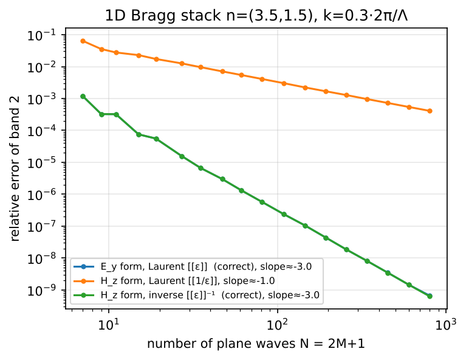
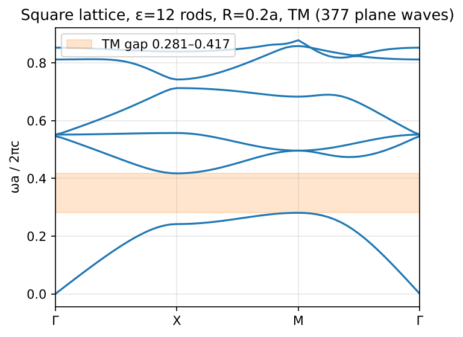
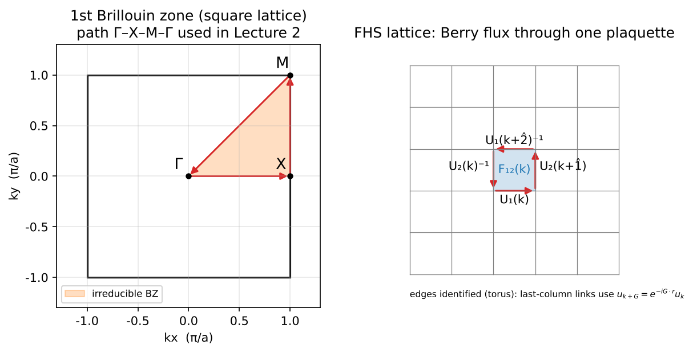
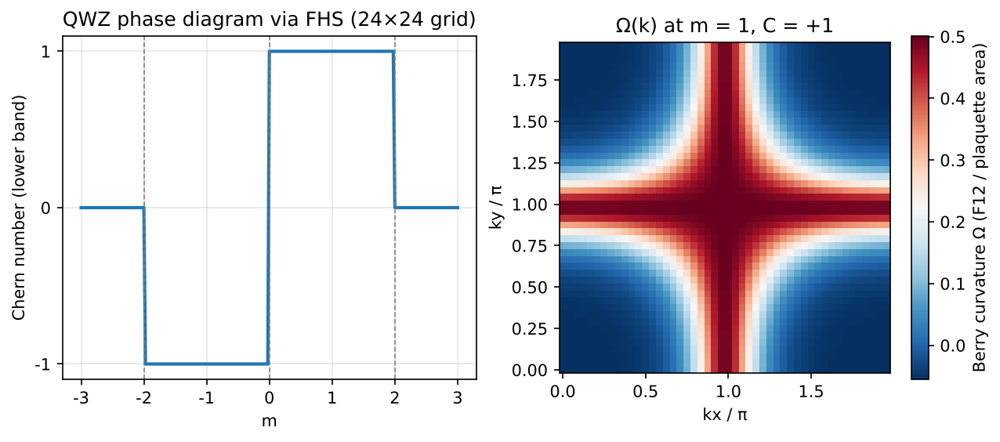
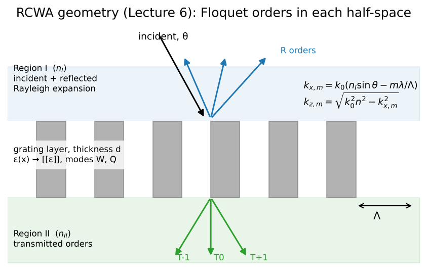
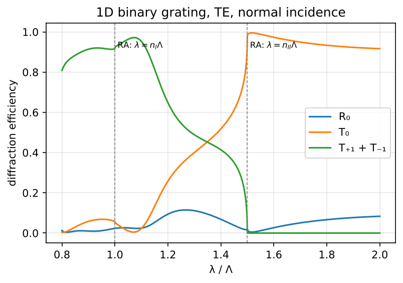
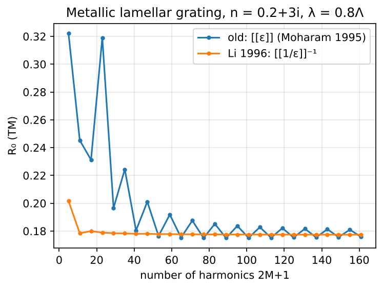
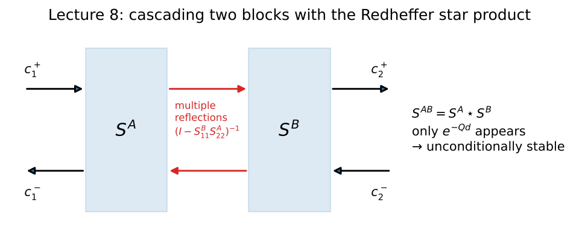
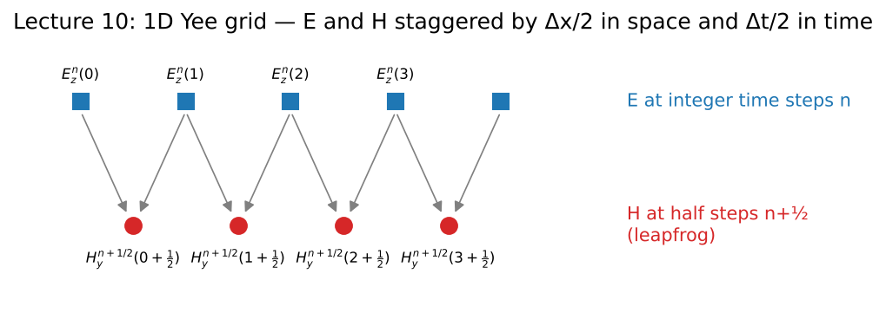

# 講義審閱報告：《計算電磁學與拓撲光子學：從平面波展開到可微分 RCWA》

審閱對象：[`lecture/lecture_notes_original.md`](../lecture/lecture_notes_original.md)（2026-10-29 版，707 行）
審閱日期：2026-11-04

> **已依本報告完成修訂**：修訂版見 [`lecture/lecture_notes.md`](../lecture/lecture_notes.md)，逐條修改紀錄見 [`changelog.md`](changelog.md)（修訂時又找出本報告之外的錯誤，一併列在其中）。
文中「L 行號」均指原始講義的行號。數值驗證程式在 [`demos/`](../demos)，圖在 [`figures/`](../figures)。

---

## 0. 總評

| 面向 | 評分 | 一句話 |
| --- | --- | --- |
| 編排順序 | ★★★★☆ | 主線（本徵問題 → PWE → 拓撲 → RCWA → 工程 → adjoint）合理；有 3 處「先用後教」 |
| 內容正確性 | ★★★★☆ | 絕大多數公式正確（已逐條核對、部分以程式驗證）；有 4 個需要修正的錯誤 |
| 來源引用 | ★★★★☆ | 卷頁大多正確；少數引錯篇、缺卷頁，有幾段方法沒有附出處 |
| 前後邏輯連貫 | ★★★★☆ | 講與講之間的呼應做得很好；時間慣例前後不一是最大的漏洞 |
| 首次出現的術語與公式 | ★★★☆☆ | 縮寫（MPB、S4、PWE、RCWA、CIS、EDA…）與幾個定理第一次出現時沒有定義 |
| 排版 | ★★☆☆☆ | ```` ```latex ```` 區塊在多數 Markdown 檢視器中不會算繪；行內數學用跳脫字元，閱讀困難 |
| 圖片／示意圖 | ★☆☆☆☆ | 全文沒有任何圖 |
| 程式 demo | ★☆☆☆☆ | 全文沒有任何程式碼，習題只給規格 |

**結論**：內容的物理與數學水準高，大部分公式經得起檢查；優先要處理的是 (1) 下面 §1 的四個錯誤，(2) 統一時間慣例與符號，(3) 改排版（數學式算繪），(4) 補圖與最小可執行範例。

---

## 1. 必須修正的錯誤

### 1.1 第 2 講習題 4：分量與規則寫反了（L147）

> 原文：「證明：當 ε 只在 x 方向不連續、而 D\_x 連續時，⟦ε⟧⁻¹ 才是 1/ε 乘法的正確截斷表示。」

依第 7 講自己列的 Li 定理：

- 法向分量：E\_x = (1/ε)·D\_x，其中 1/ε 跳、D\_x 連續 → 沒有同時跳躍 → **Laurent** ⟦1/ε⟧ 才正確（定理 1）。
- 切向分量：E\_y = (1/ε)·D\_y，其中 1/ε 與 D\_y 同時跳、乘積 E\_y 連續 → **逆規則** ⟦ε⟧⁻¹（定理 2）。

所以 ⟦ε⟧⁻¹ 正確的條件是「**切向的 E 連續**」，不是「D\_x 連續」。一維正入射、H\_z 形式時，η 作用在 D\_y 上得到 E\_y，正好是切向情形，所以結論（應該用逆規則）沒錯，但理由寫錯了。

**建議改寫**：「ε 只隨 x 變化時，對 H\_z 形式的一維 PWE，η 把 D\_y 映到 E\_y。證明：因為 E\_y 是切向分量、在介面連續，⟦ε⟧⁻¹ 才是正確的截斷表示，而 ⟦1/ε⟧ 不是。」

**數值驗證**（`demos/02_pwe_1d_rules.py`）：n = (3.5, 1.5) 的 Bragg 堆疊，第 2 條能帶對 Rytov 解析解的相對誤差：

| 形式 | 收斂階數 | N = 797 時誤差 |
| --- | --- | --- |
| E\_y 形式，Laurent ⟦ε⟧ | N⁻³ | 6.7 × 10⁻¹⁰ |
| H\_z 形式，Laurent ⟦1/ε⟧ | **N⁻¹** | 4.1 × 10⁻⁴ |
| H\_z 形式，逆規則 ⟦ε⟧⁻¹ | N⁻³ | 6.3 × 10⁻¹⁰ |



### 1.2 第 10 講：1D Yee 更新式的正負號錯誤（L534–537）

對沿 x 傳播的 (E\_z, H\_y)，由 ∇×E = −μ∂H/∂t 與 ∇×H = ε∂E/∂t 可得

$$\frac{\partial H_y}{\partial t} = +\frac{1}{\mu}\frac{\partial E_z}{\partial x},\qquad \frac{\partial E_z}{\partial t} = +\frac{1}{\varepsilon}\frac{\partial H_y}{\partial x}$$

兩條更新式都應該是 **「+」**，原文兩條都是「−」（那其實是 (E\_z, −H\_y) 或 (E\_y, H\_z) 的組合）。原文用「符號依取向而定，請自行確認」帶過，在講義中並不恰當。**建議**：直接給正確式子，刪掉那句免責說明，並附 Yee 網格示意圖（見 §6）。

### 1.3 時間慣例前後不一致（第 1、6、8 講）

- 第 1 講（L39）明定 e^(−iωt)。
- 第 6 講（L324、L334）的 exp(−i k\_x x)、層內解 e^(−Qz′)，是照搬 Moharam 1995 的寫法，而 Moharam 用的是工程慣例 e^(+jωt)。
- 第 6.3 節（L346）與第 8.3 節表格（L446）又說「取虛部為正的分支」，那是 e^(−iωt) 慣例下 e^(+ik\_z z) 會衰減的條件。
- L334 對 Q 分支的描述「取實部為正、或虛部為正」本身就模稜兩可：在 e^(−Qz′) 的寫法下應該是 Re(q) ≥ 0。

混用慣例正是 RCWA 程式最常見的錯誤來源（反射與穿透的方向對調、衰減模被當成增長模）。**建議**：在第 6 講開頭放一個「慣例框」：e^(−iωt)、e^(+ik\_x x)、前進／衰減模為 e^(+ik\_z z) 且 Im k\_z > 0，並把第 6–8 講所有公式改寫成同一套慣例；若想保留 Moharam 的寫法，就明說「本講改用 e^(+jωt)，與第 1 講相反」。`demos/04_rcwa_1d.py` 是一份全程使用 e^(−iωt) 的參考實作。

### 1.4 第 2 講驗收標準與 MPB 教學數值的關係（L145、L149）

用解析傅立葉係數的 TM PWE，已收斂到 4 位有效數字（81 → 709 個平面波，結果不變）：

| | 第 1 帶最大值 | 第 2 帶最小值 | 能隙 |
| --- | --- | --- | --- |
| 本次 PWE（709 PW） | 0.2807 | 0.4172 | 39.1% |
| MPB 教學（resolution 32） | 0.2826 | 0.4193 | 39.0% |
| 相對差 | 0.68% | 0.50% | — |

MPB 教學用的是 resolution 32，本身還沒有完全收斂。所以「與 MPB 前 6 條能帶差異 < 0.5%」這個驗收標準，**一個正確且已收斂的 PWE 程式也可能過不了**。**建議**：改成與 MPB 在 resolution ≥ 64（或做外插）時的收斂值比對，或者改成「兩者各自收斂後的差 < 0.1%」。（見 `demos/01_pwe_tm_square.py`）



---

## 2. 不夠精確、建議補強的地方

| 位置 | 問題 | 建議 |
| --- | --- | --- |
| L5、L308 | 正文說的是「Nielsen–Ninomiya **定理**」（費米子倍增 no-go 定理），但引用的 Phys. Lett. B 130, 389 (1983) 是〈ABJ anomaly and Weyl fermions in a crystal〉 | no-go 定理應引 Nucl. Phys. B 185, 20 (1981) 與 B 193, 173 (1981)；1983 那篇保留給 Weyl 半金屬的段落 |
| L277 | 「任何截斷（晶格、**動量截止**）都會把右行與左行連在一起，這就是 NN 定理」講得太廣 | NN 定理的前提是晶格上的局域性、Hermitian 性與平移不變性；改寫為「在滿足局域性、Hermitian、平移不變的晶格正規化下，手徵費米子必成對出現」 |
| L107 | 2D 且以 \|G\| 排序截斷時，⟦ε⟧ **不是** Toeplitz 矩陣（只有 1D，或 2D 用方形截斷時的二層 Toeplitz 才是） | 改稱「卷積矩陣（convolution matrix）」，並註明 1D 時是 Toeplitz |
| L122 | 把 TE 的逆規則歸功於 Li（1996），但 2D 的介面是彎曲的，純逆規則和純 Laurent 規則都不嚴格正確；把 ⟦ε⟧ 求反用在 PWE 上，最早是 Ho–Chan–Soukoulis（1990） | 補一句「ε 矩陣求反最早由 Ho、Chan、Soukoulis (1990) 使用；在 2D 彎曲介面上嚴格的做法是法向量場分解（見第 7.3 節）」 |
| L153–171 | 標題有「Berry 相位」，但全講沒有定義 | 在 3.1 加 γ\_n = ∮\_C A\_n·dk，並說明它與 Ω 的 Stokes 關係 |
| L69 | 變分原理只有文字敘述，沒有式子 | 給出 Rayleigh 商：ω²/c² = min ∫\|∇×E\|² / ∫ε\|E\|²，並說明「最低能帶把電場集中在高 ε 區」是怎麼從這個式子讀出來的 |
| L45 | Θ 的 Hermitian 性還需要邊界條件（週期或場在無窮遠衰減），文中沒寫 | 補一句 |
| L246–250 | Bulk–edge 公式的正負號取決於介面方向與 C 的符號慣例 | 註明「A 在 y < 0、B 在 y > 0，傳播方向以 +x 為右」之類的約定 |
| L236 | 固定 μ、κ 只在 4.28 GHz 成立，離這個頻率遠的能帶並不自洽 | 註明 PWE 用的是「凍結色散」近似；要嚴格處理需要對 ω 自洽迭代 |
| L457 | 「交換入射與出射方向，對應的穿透係數相等」講得不清楚 | 寫成光柵互易定理：入射 k\_x 時第 m 階的效率，等於從第 m 階出射方向反向入射（k\_x′ = −k\_(x,m)）時回到原入射方向的效率 |
| L409 | 「與文獻數值一致至 3 位有效數字」沒有指定是哪個文獻 | 指定基準，例如 Li (1996) 或 Lalanne & Morris (1996) 的金屬光柵表格，並寫出幾何參數 |
| L478、L512 | 要求 C++ 與 Python「逐位比對」、差 < 10⁻¹² | 不同 LAPACK／Eigen 的本徵向量相位與順序是任意的，病態時誤差也會被放大；改成比較物理輸出（效率、S 參數），容差以條件數衡量，例如 10⁻¹⁰ |
| L582–595 | λ 同時當伴隨變數（11.1）、本徵值（11.2）與波長（第 6 講）；Λ 同時是本徵值矩陣與光柵週期 | 換符號（例如伴隨變數用 **v** 或 x̃、本徵值矩陣用 D）；並補上 RCWA 的本徵值是 q²，所以 dQ = dD / (2Q) 這一步鏈鎖律 |
| L334 | d′ 沒有定義 | 補上 d′ = k₀d |

---

## 3. 編排順序與前後邏輯

整體順序正確：本徵問題（L1）→ 數值化（L2）→ 幾何／拓撲（L3–4）→ 固定頻率的散射問題（L6–8）→ 工程化（L9）→ 時域與 GPU（L10）→ 梯度（L11）。講與講之間的伏筆（例如 L2 的逆規則 → L7 的 Li 定理、L6 的指數參考點 → L8 的穩定性、L4 的 bulk–edge → L5 的 anomaly inflow）做得很好。需要調整的有：

1. **先用後教（3 處）**
   - L75：第 1 講習題 3 要「用轉移矩陣」推 Rytov 關係，但轉移矩陣到第 8 講才出現，而且第 8 講還假設讀者已經會用。→ 在第 1 講加 1 段 2 × 2 轉移矩陣的介紹，第 8 講改成回頭引用它。
   - L147：第 2 講習題 4 要求證明 Li 定理的一個特例，但定理在第 7 講才陳述。→ 在第 2.2 節放一個「Li 規則預告框」（列出定理 1、2 各一行），或把習題移到第 7 講。
   - L250：第 4 講說「這條式子就是第 5 講的 anomaly inflow」，但第 5 講是伴讀，可能還沒讀到。→ 改成「（伴讀者可參見第 5.2 節）」。
2. **伴讀講次的位置**：第 5 講插在主線第 4、6 講之間，打斷了「拓撲 → RCWA」的閱讀節奏。建議改為「附錄 A」或「第 4.5 講（伴讀）」，主線編號保持連續。
3. **時程表的不一致**：
   - 表格（L17–25）只有第一到第三階段，附錄（L649）卻出現「第三、四階段（9–24 個月）」，第四階段從沒定義。
   - 第 10 講的時程只寫「並行」，沒有月份。
   - 開頭寫「兩年計畫」，但沒有說明各階段的月數如何對應。
4. **課程內容與個人計畫混在一起**：「公司工作」「勞動契約」「OneDrive」「EDA 公司看重」「作品集」「應徵職缺」（L24、L478、L497、L525、L631、L655）屬於個人執行計畫，不屬於講義。若講義要公開或給他人使用，建議把這些移到另一份「個人執行計畫」附錄。
5. **無法查證的宣稱**：L7「水準對標史丹佛 EE 研究所…課程」沒有指名課程，建議刪除或寫出具體課號。

---

## 4. 第一次出現但未說明的術語、定理、符號

| 首次出現 | 術語 | 建議補充 |
| --- | --- | --- |
| L7 | PWE、RCWA、FDTD | 在課程概述用一句話定義全名與用途 |
| L13 | MPB、S4 | 「MPB：MIT Photonic Bands，頻域本徵求解器；S4：Stanford Stratified Structure Solver，RCWA 實作」，並附網址 |
| L45 | Hermitian「半正定」 | 一句話說明為何 ω² ≥ 0 |
| L55 | 第一布里淵區、倒晶格向量 G | 加一張布里淵區與高對稱點的圖（已附，見 §6） |
| L69 | 變分原理 | 見 §2 |
| L75 | 轉移矩陣、Rytov | 見 §3 |
| L122 | Laurent 規則（名稱的由來） | 說明它就是直接拿截斷的 Laurent（傅立葉）級數相乘 |
| L129 | J₁（Bessel 函數） | 註明是第一類一階 Bessel 函數，並寫出推導的一行（對圓盤做傅立葉積分） |
| L132 | Gibbs 振盪、次像素平滑 | 各一句定義 |
| L155 | 規範（gauge） | 3.1 節有說明，但「規範」這個詞在 L155 已經先出現 |
| L177 | valley 光子晶體、valley Chern 數 | 一句定義，並附出處（例如 Ma & Shvets, NJP 18, 025012 (2016)） |
| L216 | 旋磁（gyromagnetic）、YIG、鐵氧體 | 一句說明（YIG = 釔鐵石榴石） |
| L236 | 二次型簡併 | 說明與 Dirac 錐（線性簡併）的差別 |
| L265 | 手徵流、軸流、正規化 | 第 5 講預設讀者有 QFT 背景；至少給 j₅^μ = ψ̄γ^μγ₅ψ 的定義 |
| L297 | Atiyah–Singer 指標定理、熱核 | 一行敘述與參考文獻 |
| L352 | Wood anomaly | 區分 Rayleigh anomaly（純幾何）與共振型 Wood anomaly（導模） |
| L429 | Redheffer 星積 | 給出名字的出處 (Redheffer, 1962) |
| L463 | Fano 共振、Q 值 | 一句定義 |
| L494 | Eigen、zgeev、scikit-build-core、cibuildwheel | 加一個工具表 |
| L543 | CIS | 「CMOS image sensor」 |
| L547 | 拉伸座標、複頻移 PML、遞迴卷積 | 各一句說明 |
| L554 | roofline、算術強度 | 給公式：性能上限 = min(峰值 FLOP/s, 頻寬 × 算術強度) |
| L567 | harminv | 「filter diagonalization 擷取共振頻率」，引 Mandelshtam & Taylor, J. Chem. Phys. 107, 6756 (1997) |
| L588 | Wirtinger 導數 | 給 ∂/∂z = ½(∂/∂x − i∂/∂y)，並說明 df/dp = 2 Re(…) 這個常用形式 |
| L607 | 密度濾波、tanh 投影 | 寫出公式並引 Wang、Lazarov、Sigmund, Struct. Multidisc. Optim. 43, 767 (2011) |

**建議**：在課程概述後加一份全書「符號與慣例表」（時間慣例、傅立葉慣例、⟦·⟧ 的定義、k₀、k\_x、K\_x、W、Q、d′、各講的 λ／Λ），可以一次解決大部分符號衝突。

---

## 5. 來源引用

### 5.1 已核對、正確的引用（抽查）
Ho–Chan–Soukoulis PRL 65, 3152 (1990)；Sözüer–Haus–Inguva PRB 45, 13962 (1992)；Li JOSA A 13, 1870 / 13, 1024 (1996)、14, 2758 (1997)；Lalanne & Morris JOSA A 13, 779 (1996)；Granet & Guizal JOSA A 13, 1019 (1996)；Moharam 等人 JOSA A 12, 1068 / 1077 (1995)；FHS JPSJ 74, 1674 (2005)；Xiao–Chang–Niu RMP 82, 1959 (2010)；QWZ PRB 74, 085308 (2006)；Wang 等人 PRL 100, 013905 (2008) 與 Nature 461, 772 (2009)；Haldane & Raghu PRL 100, 013904 (2008)；Lu 等人 Nat. Photon. 8, 821 (2014)；Callan & Harvey NPB 250, 427 (1985)；Rumpf PIER B 35, 241 (2011)；Liu & Fan CPC 183, 2233 (2012)；Fan & Joannopoulos PRB 65, 235112 (2002)；Roden & Gedney MOTL 27, 334 (2000)；Oskooi 等人 CPC 181, 687 (2010)；Schuster 等人 JOSA A 24, 2880 (2007)；Molesky 等人 Nat. Photon. 12, 659 (2018)；Hughes 等人 ACS Photonics 5, 4781 (2018)；Jin 等人 ACS Photonics 7, 2350 (2020)；Sell 等人 Nano Lett. 17, 3752 (2017)；Kim & Lee CPC 282, 108552 (2023)；Hammond 等人 Opt. Express 30, 4467 (2022)。

### 5.2 需要修正或補上的引用

| 位置 | 問題 | 建議 |
| --- | --- | --- |
| L277、L308 | Nielsen–Ninomiya 引錯篇 | 補 NPB 185, 20 (1981)、NPB 193, 173 (1981) |
| L299、L672 | 「Lu 等人, Science 2015」沒有卷頁 | Science 349, 622 (2015) |
| L398 | 法向量場／快速傅立葉因式分解的源頭沒有引 | Popov & Nevière, JOSA A 17, 1773 (2000)；Götz 等人, Opt. Express 16, 17295 (2008) |
| L429 | Redheffer 星積沒有出處 | R. Redheffer, J. Math. Phys. 41, 1 (1962) |
| L567 | harminv 沒有出處 | Mandelshtam & Taylor (1997) |
| L572、L665 | Taflove & Hagness 沒有寫版次 | 第 3 版（Artech House, 2005） |
| L607 | 拓撲最佳化的濾波與投影沒有出處 | Wang–Lazarov–Sigmund (2011)；Bourdin, IJNME 50, 2143 (2001) |
| L598 | 「grcwa 與 TORCWA 分別示範了…Lorentzian 展寬」 | Lorentzian 展寬出自 TORCWA 論文；grcwa 是用 autograd 自動微分。建議分開寫清楚 |
| L308 | Tong〈Gauge Theory〉節號 | ✅ 2026-11-04 已以第 3 章 PDF 確認：3.1.1、3.2.2、3.3.1 正確，且第 3 章內文明寫 anomaly inflow「will be described in Section 4.4.1」。原稿正確 |
| L145 | MPB 數值 | 加上「resolution = 32」，避免讀者誤以為那是收斂值 |
| L85、L664 | Sakoda 書名缺出版資訊（附錄中） | 附錄與 L85 寫法統一：Springer, 2001 |
| 全文 | 正文的引用格式（「作者, 期刊 卷, 頁 (年)」）與附錄（「作者（年）」）不一致 | 統一用編號引用 [1]、[2]…，附錄列完整條目，並附 DOI |

---

## 6. 排版

1. **數學式不會算繪**：全文 30 多個 ```` ```latex ```` 區塊，在 GitHub、VS Code 預覽、Obsidian 等環境中都會以原始碼顯示。→ 改用 `$$ … $$`（GitHub、Typora、Obsidian、HackMD 都支援），或 GitHub 專用的 ```` ```math ````。
2. **行內數學**：`ω\_n(k)`、`k\_(x,m)`、`ε\_(G−G′)`、`F\*·G`、`J = \[\[0, 1\], \[−1, 0\]\]` 用跳脫字元與括號模擬下標，又醜又容易誤讀。→ 統一用 `$\omega_n(\mathbf k)$`、`$k_{x,m}$`，J 用 `pmatrix`。
3. **過長的單行公式**：L62（TM 與 TE 擠在同一行）、L534（Yee 兩式在同一行）、L129（公式內夾中文註解）。→ 拆成 `aligned`，註解放到公式外。
4. **公式沒有編號**：講義內常互相引用（「第 6 講的公式」），建議加上 (1.1)、(6.3) 這類編號。
5. **結構**：每講固定的「核心結論／學習目標／習題／驗收標準／閱讀」很好；建議把「核心結論」做成醒目的提示框（`> **核心結論**`），並在每講末加「本講符號」小表。
6. **表格**：L17 的大綱表與 L444 的陷阱表排版良好，可保留。

---

## 7. 圖片與示意圖

原始講義**沒有任何圖**。下列概念只靠文字很難理解，建議補圖（✅ 表示本次已產生，可直接引用）：

| 講次 | 建議的圖 | 狀態 |
| --- | --- | --- |
| 1–2 | 方晶格布里淵區、不可約區、Γ–X–M–Γ 路徑 | ✅ `figures/l01_l03_bz_and_fhs.png`（左） |
| 2 | TM 能帶圖與能隙 | ✅ `figures/l02_pwe_tm_bands.png` |
| 2 | Laurent 規則與逆規則的收斂比較 | ✅ `figures/l02_pwe_1d_laurent_vs_inverse.png` |
| 3 | FHS 格點與 plaquette 上的 link 變數 | ✅ `figures/l01_l03_bz_and_fhs.png`（右） |
| 3 | QWZ 相圖與 Berry 曲率分佈 | ✅ `figures/l03_qwz_fhs.png` |
| 4 | Wang 2008 結構示意、疇壁超晶胞、投影能帶中的邊緣模 | 建議補（需要旋磁 PWE） |
| 5 | 1+1 維譜流示意（Dirac 海在電場下平移） | 建議補 |
| 6 | RCWA 幾何、各區域的展開、繞射階 | ✅ `figures/l06_rcwa_geometry.png` |
| 6 | 繞射效率對波長，以及 Rayleigh anomaly 的位置 | ✅ `figures/l06_rcwa_te_spectrum.png` |
| 7 | 金屬光柵 TM：舊公式與 Li 法則的收斂比較 | ✅ `figures/l07_tm_metal_convergence.png` |
| 7 | 法向量場示意（圓柱周圍的 n̂ 場） | 建議補 |
| 8 | S 矩陣串接與多重反射 | ✅ `figures/l08_smatrix_cascade.png` |
| 10 | Yee 網格（1D 交錯；3D Yee cell） | ✅ 1D：`figures/l10_yee_1d.png`；3D 建議補 |
| 10 | Roofline 示意 | 建議補 |
| 11 | 正向／伴隨計算流程圖；濾波 → 投影 → 二值化的三步驟示意 | 建議補 |









---

## 8. 程式 demo

原始講義的每講都有「可執行的程式作業」，但**全文一行程式碼也沒有**。對研究所課程來說，至少應該為每講提供一個約 50–100 行的最小參考實作或骨架，讓學生知道資料結構與 API 的形狀。本次補上的 demo 同時也用來驗證講義的公式：

| 程式 | 對應 | 驗證了什麼 | 結果 |
| --- | --- | --- | --- |
| `demos/01_pwe_tm_square.py` | L2 習題 2 | 2D TM PWE、圓柱解析係數、`eigh(K, Eps)` | 收斂能隙 0.2807–0.4172（39.1%）；與 MPB res=32 差約 0.5–0.7%，見 §1.4 |
| `demos/02_pwe_1d_rules.py` | L1 習題 3、L2 習題 1、3、4 | Rytov 關係；Laurent 與逆規則的收斂階數 | 逆規則 N⁻³、Laurent N⁻¹，見 §1.1 |
| `demos/03_qwz_fhs_chern.py` | L3 習題 2、4 | FHS 公式、QWZ 相圖 | m = ±1 → C = ±1、\|m\| > 2 → C = 0；4×4 網格就已是精確整數 |
| `demos/04_rcwa_1d.py` | L6 習題 2、3；L7 習題 2 | TE／TM 的 RCWA、DE 公式、Li 法則 | 能量守恆誤差 10⁻¹⁴；薄膜極限與 Airy 公式一致到 12 位；金屬 TM 用 Li 法則約 20 階就收斂，舊公式到 160 階仍在振盪 |
| `demos/05_schematics.py` | L1–3、6、8、10 | 產生示意圖 | — |

執行方式：`pip install numpy scipy matplotlib && cd demos && python 01_pwe_tm_square.py`（其餘類推），圖會輸出到 `figures/`。

**建議之後補上**的 demo：L4 旋磁 PWE 與疇壁超晶胞（`demos/01` 加上 ν̃ 即可）、L8 多層 S 矩陣與 T 矩陣失敗的對照、L10 1D FDTD + CPML、L11 用 JAX 重寫 `04_rcwa_1d.py` 並做梯度檢查。

---

## 9. 修改優先順序建議

1. **立即**：§1 的四項（習題 2.4、Yee 正負號、時間慣例、MPB 驗收標準）。
2. **短期**：數學排版改成 `$$`／`$`；加全書符號與慣例表；修正 §5.2 的引用。
3. **中期**：補「先用後教」的三處、首次出現術語的定義（§4）；把個人計畫內容移到附錄。
4. **長期**：每講附一個最小 demo 與 1–2 張圖（§7、§8 已完成約一半）。
